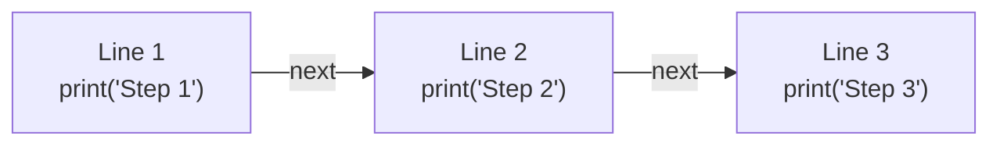
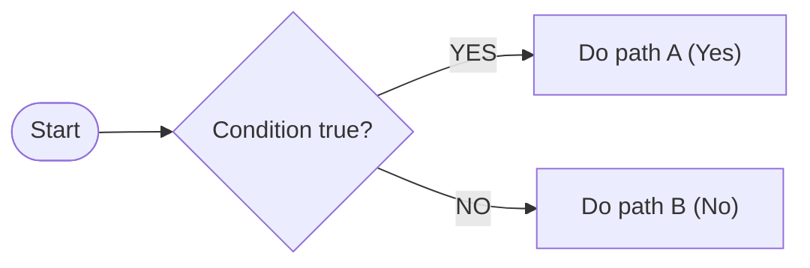
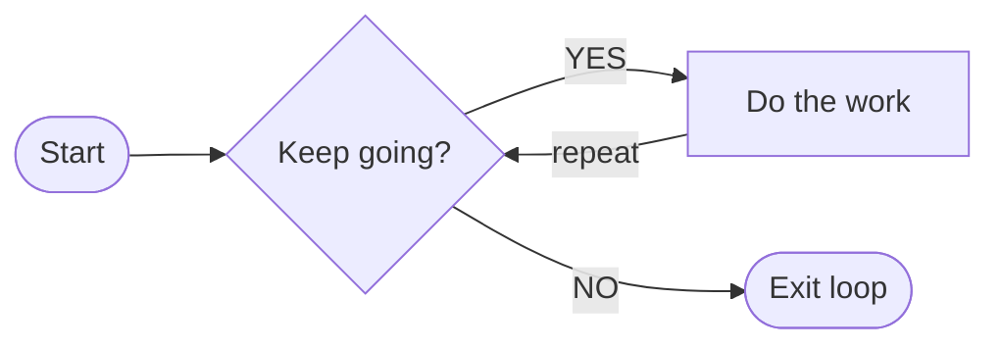
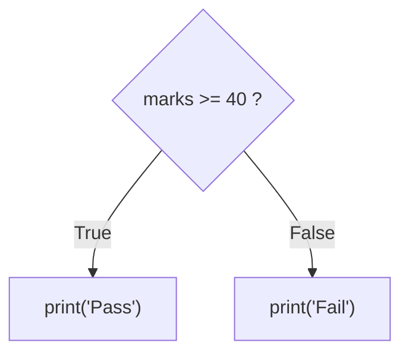
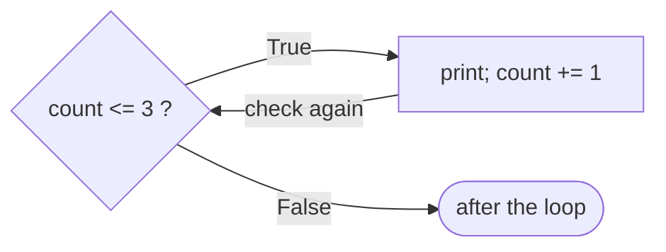

# Python Chapter 03: Control Flow

### The Complete Deep Dive

From "why does this even exist?" to building real applications. Every decision, every loop, every trap, with real executed outputs and a large category-wise application bank.

**Teaching order used everywhere:** Concept → Syntax → Runnable example → Real output → Line-by-line → Variations & traps → Graded practice

> Every output block in this book was produced by actually running the code. Nothing is typed by hand.

## Table of Contents

- [How to Use This Book](#how-to-use-this-book)
  - [The teaching order (never changes)](#the-teaching-order-never-changes)
  - [Level labels](#level-labels)
- [Section 3.1 — The Philosophy of Control Flow (Beginner’s Mind)](#section-31--the-philosophy-of-control-flow-beginners-mind)
  - [3.1.1 What is control flow?](#311-what-is-control-flow)
  - [3.1.2 Life without control flow: what did people do, and why was it painful?](#312-life-without-control-flow-what-did-people-do-and-why-was-it-painful)
  - [3.1.3 The 3 Pillars of control flow](#313-the-3-pillars-of-control-flow)
  - [3.1.4 The Big Rule: Selection or Iteration?](#314-the-big-rule-selection-or-iteration)
  - [3.1.5 Side by side: same problem, with and without control flow](#315-side-by-side-same-problem-with-and-without-control-flow)
  - [3.1.6 The 5-step Thinking Recipe (use this on EVERY problem)](#316-the-5-step-thinking-recipe-use-this-on-every-problem)
  - [3.1.7 The 10 Code Skeletons (templates you will reuse hundreds of times)](#317-the-10-code-skeletons-templates-you-will-reuse-hundreds-of-times)
- [Section 3.2 — Conditional Statements (Selection)](#section-32--conditional-statements-selection)
  - [3.2.1 The if statement: the first decision](#321-the-if-statement-the-first-decision)
  - [3.2.2 The if-else statement: two-way fork](#322-the-if-else-statement-two-way-fork)
  - [3.2.3 The if-elif-else statement: multi-way fork](#323-the-if-elif-else-statement-multi-way-fork)
  - [3.2.4 The “First Match Wins” rule: order your elif blocks](#324-the-first-match-wins-rule-order-your-elif-blocks)
  - [3.2.5 Nested if: decisions inside decisions](#325-nested-if-decisions-inside-decisions)
  - [3.2.6 The ternary operator: one-line if-else](#326-the-ternary-operator-one-line-if-else)
  - [3.2.7 The match-case statement (Python 3.10+): pattern matching](#327-the-match-case-statement-python-310-pattern-matching)
  - [3.2.8 The Ultimate Decision Rule: if-elif vs match-case vs dictionary](#328-the-ultimate-decision-rule-if-elif-vs-match-case-vs-dictionary)
  - [3.2.9 Common conditional pitfalls](#329-common-conditional-pitfalls)
- [Section 3.3 — Loops (Iteration)](#section-33--loops-iteration)
  - [3.3.1 The while loop: loop until a condition changes](#331-the-while-loop-loop-until-a-condition-changes)
  - [3.3.2 The for loop: for every item in a collection](#332-the-for-loop-for-every-item-in-a-collection)
  - [3.3.3 The Ultimate Decision Rule: for vs while](#333-the-ultimate-decision-rule-for-vs-while)
  - [3.3.4 range(): the engine of for loops](#334-range-the-engine-of-for-loops)
  - [3.3.5 break: exit the loop immediately](#335-break-exit-the-loop-immediately)
  - [3.3.6 continue: skip the rest of THIS round](#336-continue-skip-the-rest-of-this-round)
  - [3.3.7 pass: the do-nothing placeholder](#337-pass-the-do-nothing-placeholder)
  - [3.3.8 for-else and while-else: the hidden feature](#338-for-else-and-while-else-the-hidden-feature)
  - [3.3.9 Nested loops: a loop inside a loop](#339-nested-loops-a-loop-inside-a-loop)
  - [3.3.10 Common loop pitfalls](#3310-common-loop-pitfalls)
- [Section 3.4 — The Master Application & Variation Bank](#section-34--the-master-application--variation-bank)
  - [3.4.1 Level 1 — Absolute Basic Applications (20 problems)](#341-level-1--absolute-basic-applications-20-problems)
  - [3.4.2 Level 2 — Intermediate Applications (30 problems)](#342-level-2--intermediate-applications-30-problems)
  - [3.4.3 Level 3 — Advanced & Algorithmic Applications (20 problems)](#343-level-3--advanced--algorithmic-applications-20-problems)
  - [3.4.4 The Variation Matrix — category-wise problems](#344-the-variation-matrix--category-wise-problems)
  - [3.4.5 The TRAP Vault (code that looks right but surprises you)](#345-the-trap-vault-code-that-looks-right-but-surprises-you)
  - [3.4.6 Output Prediction & Trace Tables](#346-output-prediction--trace-tables)
- [Section 3.5 — Competitive Programming & Interview Prep](#section-35--competitive-programming--interview-prep)
  - [3.5.1 Interview questions with model answers](#351-interview-questions-with-model-answers)
  - [3.5.2 Platform-specific problem index (from your index)](#352-platform-specific-problem-index-from-your-index)
- [Section 3.6 — Chapter Projects](#section-36--chapter-projects)
  - [3.6.1 The Number Guessing Game](#361-the-number-guessing-game)
  - [3.6.2 Menu-Driven ATM Simulator](#362-menu-driven-atm-simulator)
  - [3.6.3 Pattern Generator Tool](#363-pattern-generator-tool)
  - [3.6.4 Prime Sieve Implementation](#364-prime-sieve-implementation)
- [Chapter 3 Summary — The 30 Golden Rules of Control Flow](#chapter-3-summary--the-30-golden-rules-of-control-flow)
  - [Error Message Decoder (every message below is real)](#error-message-decoder-every-message-below-is-real)
- [Final Exam — 30 Mixed HARD and TRAP Questions](#final-exam--30-mixed-hard-and-trap-questions)
- [Answer Key (every output below was produced by running the code)](#answer-key-every-output-below-was-produced-by-running-the-code)
  - [TRAP Vault answers](#trap-vault-answers)
  - [Trace Table answers (machine-generated, one row per executed line)](#trace-table-answers-machine-generated-one-row-per-executed-line)
  - [Final Exam answers](#final-exam-answers)

---

## How to Use This Book

**You told me the real problem: you know the concept, but when a question arrives you freeze.** That is extremely common, and it is not a memory problem. It is a **translation problem**: nobody taught you how to turn an English sentence (“count the vowels”) into code. So this book is built differently from a normal syllabus.

| Part | What it gives you | Why it fixes your problem |
|---|---|---|
| 3.1 | Why control flow exists + the **5-step thinking recipe** + **10 code skeletons** | You get a repeatable way to start ANY question |
| 3.2 | Every conditional: if, if-else, if-elif-else, nested, ternary, match-case | Decision making, with decision rules |
| 3.3 | Every loop tool: while, for, range, break, continue, pass, else, nested | Repetition, with decision rules |
| 3.4 | **The Application Bank**: problems grouped by category, each with real output | This is where you build the skill. Most pages are here |
| 3.5-3.6 | TRAP vault, trace tables, interview questions, projects, exam, answer key | Testing yourself and catching mistakes |

### The teaching order (never changes)

- **Concept**: what it is and why, in plain words, with an everyday analogy.
- **Syntax**: the exact shape of the code.
- **Runnable example**: the smallest program that shows it.
- **Real output**: executed by Python while building this PDF.
- **Line-by-line**: what each line does, as bullets.
- **Variations and consequences**: what changes if you tweak it, and what breaks.
- **Graded practice**: BASIC → MID → HARD → TRAP.

### Level labels

| Label | Meaning |
|---|---|
| BASIC | Direct recall. One idea. |
| MID | You need the mental model. Two ideas combined. |
| HARD | Several ideas combined, or a small algorithm. |
| TRAP | Looks easy and hides a pitfall. Predict carefully! |

> 💡 **TIP · How to study this PDF**
>
> For every problem in 3.4: **cover the code, read only the title, and try it yourself for 5 minutes** (on paper first). Then compare. If you were stuck, do not just read the solution: re-type it from memory the next day.
>
> Use the **skeleton** (3.1.7) that matches the problem’s wording. Most problems are a skeleton plus one small twist.

---

## Section 3.1 — The Philosophy of Control Flow (Beginner’s Mind)

Goal: before writing a single clever line, understand **why** control flow exists. If you know why, you will know when to use what.

### 3.1.1 What is control flow?

**A program is a list of instructions. Control flow means: the order in which those instructions run.** By default, Python reads from the top line to the bottom line, one line at a time. That default is called **sequential flow.**

**Analogy:** a recipe card. Step 1: boil water. Step 2: add noodles. Step 3: add masala. You do them in order. But real recipes also say “if the water is boiling, add noodles” and “stir until thick”. Those words (**if**, **until**) are control flow.

**Diagram: sequential flow (the default)**



**Example 1 — Sequential flow**

```python
print('Step 1')
print('Step 2')
print('Step 3')
```

*Output:*

```text
Step 1
Step 2
Step 3
```

- Python runs line 1, then line 2, then line 3. No skipping, no repeating.
- The order of the output equals the order of the lines. That is the whole idea of sequence.

> 📘 **RULE · Definition**
>
> **Control flow = the decisions and repetitions that change the default top-to-bottom order.**

### 3.1.2 Life without control flow: what did people do, and why was it painful?

Imagine a language that only has sequence. Every program would be a straight line from start to end. Let us feel the pain.

**Pain 1: no decisions (a login that cannot choose)**

Without `if`, you would need a **separate program** for each possible situation. One script for “correct password”, another for “wrong password”, and a human would have to decide which script to launch. The computer itself could not decide.

**Example 2 — Script A (for the correct password)**

```python
# Script A: only works if the password is right
print('Welcome, you are logged in')
```

*Output:*

```text
Welcome, you are logged in
```

**Example 3 — Script B (for the wrong password)**

```python
# Script B: only works if the password is wrong
print('Access denied')
```

*Output:*

```text
Access denied
```

Two programs for one tiny question. Imagine a game with a million possible situations.

**Pain 2: no repetition (copy-paste forever)**

**Example 4 — Printing Hello 5 times, the sequential way**

```python
print('Hello')
print('Hello')
print('Hello')
print('Hello')
print('Hello')
```

*Output:*

```text
Hello
Hello
Hello
Hello
Hello
```

- 5 times = 5 lines. 1000 times = 1000 lines. 1 million times = 1 million lines.
- If the message must change from Hello to Namaste, you must edit every single line.

**Example 5 — The same job with control flow**

```python
for i in range(5):
    print('Hello')
```

*Output:*

```text
Hello
Hello
Hello
Hello
Hello
```

- Two lines, no matter whether it is 5 or 5 million. Changing the message needs one edit.

**Pain 3: the historic mess (GOTO and spaghetti code)**

Early programming languages did have jumps: an instruction like “go to line 40”. Programmers used these jumps to build decisions and loops by hand. Large programs became tangled: the flow jumped everywhere, like a bowl of spaghetti. Nobody could follow them or fix them.

In **1966** two computer scientists, Böhm and Jacopini, proved that any program can be written using only three building blocks. In **1968** Edsger Dijkstra published his famous letter against the uncontrolled “go to”. The industry moved to **structured programming**: use only these three well-behaved blocks. That is the control flow you are learning now.

> 📌 **REMEMBER · Why this matters to you**
>
> Control flow is not an optional extra. It is the **only** way a program can react to data and repeat work. Every app you use (UPI, Instagram, a calculator, a game) is just these 3 blocks combined in clever ways.

### 3.1.3 The 3 Pillars of control flow

| Pillar | Plain meaning | Everyday sentence | Python tools |
|---|---|---|---|
| **Sequence** | Run lines top to bottom | Wake up, brush, eat | (default) |
| **Selection** (branching) | Choose one path | IF it is raining, take an umbrella | `if elif else match-case` |
| **Iteration** (looping) | Repeat | Stir UNTIL the soup is thick | `while for` + `break continue else` |

**Diagram: Selection = a fork in the road**



**Diagram: Iteration = a loop that returns to the question**



### 3.1.4 The Big Rule: Selection or Iteration?

> 📘 **RULE · The Big Rule**
>
> Need to **choose** between paths, once? → **Selection** (`if`).
>
> Need to **repeat** an action? → **Iteration** (`for` / `while`).
>
> Need to repeat AND choose inside each repetition? → a **loop with a decision inside** (this is most real problems!).

| If the sentence says… | Think… | Tool |
|---|---|---|
| “check whether / if / is it…” | one decision | `if` |
| “grade / category / slab / which range” | many ways, exactly one wins | `if-elif-else` |
| “print 1 to N”, “for each item”, “N times” | known repeat count / collection | `for` |
| “keep asking until”, “while balance > 0”, “until it becomes” | unknown repeat count | `while` |
| “count how many numbers satisfy…” | loop + decision inside | `for` + `if` |
| “stop as soon as found” | early exit | `break` |

### 3.1.5 Side by side: same problem, with and without control flow

**Problem 1: is a number positive, negative or zero?**

**Example 6 — Sequential attempt (BROKEN)**

```python
n = -7
print('Positive')
print('Negative')
print('Zero')
```

*Output:*

```text
Positive
Negative
Zero
```

- It prints all three answers. Sequence cannot choose, so it cannot answer the question.

**Example 7 — Selection (PERFECT FIT)**

```python
n = -7
if n > 0:
    print('Positive')
elif n < 0:
    print('Negative')
else:
    print('Zero')
```

*Output:*

```text
Negative
```

- Exactly one message is printed. That is a decision.

**Problem 2: print the first 10 numbers**

**Example 8 — Selection / sequence only (TERRIBLE)**

```python
print(1)
print(2)
print(3)
print(4)
print(5)
print(6)
print(7)
print(8)
print(9)
print(10)
```

*Output:*

```text
1
2
3
4
5
6
7
8
9
10
```

**Example 9 — Iteration (PERFECT FIT)**

```python
for i in range(1, 11):
    print(i)
```

*Output:*

```text
1
2
3
4
5
6
7
8
9
10
```

- Same output. Ten lines became two. Changing 10 to 1000 is a one-character edit.

### 3.1.6 The 5-step Thinking Recipe (use this on EVERY problem)

This is the missing piece for “I know the concept but cannot make the application”. Follow these steps in **order, on paper, before typing code.**

| Step | Question to ask yourself | Example: “count numbers 1-100 divisible by 7” |
|---|---|---|
| 1. Do it by hand | If I had to do this with a pencil for a small case, what would I do? | Look at 1,2,3… for each, ask “is it divisible by 7?”. Keep a tally. |
| 2. Inputs & output | What goes in? What must come out? (one number? a list? printed lines?) | In: range 1..100. Out: ONE number (the tally). |
| 3. Spot the shape | Is there REPEATING? Is there a DECISION? Is there something I must REMEMBER? | Repeat over 1..100. Decision: divisible by 7? Remember: the tally. |
| 4. Write plain English | Write the steps as short sentences (pseudocode). | tally = 0. For each number n from 1 to 100: if n divisible by 7, tally goes up by 1. Print tally. |
| 5. Translate & test | Convert each sentence to a line. Test on a tiny case and an edge case. | Try 1..20: should be 2 (7 and 14). |

**Example 10 — Step 5 result**

```python
count = 0                      # remember: the tally
for n in range(1, 101):        # repeat over 1..100
    if n % 7 == 0:             # decision: divisible by 7?
        count += 1             # update the tally
print(count)
```

*Output:*

```text
14
```

- Notice: every English sentence from step 4 became exactly one line or block.
- `n % 7 == 0` means “remainder after dividing by 7 is zero”, i.e. divisible by 7.

> 💡 **TIP · The 3 questions**
>
> Whenever you are stuck, ask: **(1) What repeats? (2) What decision happens? (3) What must I remember between steps?** Those three answers are almost the entire program.

### 3.1.7 The 10 Code Skeletons (templates you will reuse hundreds of times)

Most application problems are one of these skeletons with a small twist. **Learn these ten shapes. They are your toolkit.**

**Skeleton 1: Counter — “count how many…”**

**Example 11 — Counter**

```python
count = 0
for x in [4, 9, 12, 7, 20, 3]:
    if x > 5:          # the condition changes per problem
        count += 1
print('count =', count)
```

*Output:*

```text
count = 4
```

- Start the counter at 0, loop through everything, add 1 whenever the condition is true.

**Skeleton 2: Accumulator — “sum / total / product…”**

**Example 12 — Accumulator (sum)**

```python
total = 0
for x in [4, 9, 12, 7, 20, 3]:
    total += x
print('total =', total)
```

*Output:*

```text
total = 55
```

- Start from 0 for sums. Start from **1** for products (0 would kill the product).

**Skeleton 3: Best-so-far — “largest / smallest…”**

**Example 13 — Max finder**

```python
nums = [4, 9, 12, 7, 20, 3]
biggest = nums[0]        # start with the first item, NOT with 0
for x in nums:
    if x > biggest:
        biggest = x
print('largest =', biggest)
```

*Output:*

```text
largest = 20
```

- Starting with `0` fails if all numbers are negative. Start with the first element.

**Skeleton 4: Flag — “is every / does any…”**

**Example 14 — Flag + break**

```python
nums = [4, 9, 12, 7, 20, 3]
found = False
for x in nums:
    if x == 7:
        found = True
        break
print('found 7?', found)
```

*Output:*

```text
found 7? True
```

- Assume False, switch to True if you ever see evidence, and stop early.

**Skeleton 5: Digit peeler — “for each digit of a number…”**

**Example 15 — Digit peeler**

```python
n = 8723
while n > 0:
    digit = n % 10      # last digit
    print(digit)
    n = n // 10         # chop the last digit off
```

*Output:*

```text
3
2
7
8
```

- `% 10` reads the last digit. `// 10` removes it. Repeat while something remains.

**Skeleton 6: Sentinel loop — “keep asking until…”**

**Example 16 — Sentinel loop**

*Input typed by the user: hi, python, exit*

```python
while True:
    word = input('Type something (exit to stop): ')
    if word == 'exit':
        break
    print('You typed', word)
```

*Output:*

```text
Type something (exit to stop): hi
You typed hi
Type something (exit to stop): python
You typed python
Type something (exit to stop): exit
```

- We do not know how many times the user will type, so `while True` + `break`.

**Skeleton 7: Build-a-result — “make a new list/string…”**

**Example 17 — Build a list**

```python
result = []
for x in range(1, 11):
    if x % 2 == 0:
        result.append(x * x)
print(result)
```

*Output:*

```text
[4, 16, 36, 64, 100]
```

- Start with an empty container, add inside the loop, print after the loop.

**Skeleton 8: Grid — “rows and columns / patterns”**

**Example 18 — Nested loops**

```python
for row in range(1, 4):         # outer loop = rows
    for col in range(1, 5):     # inner loop = columns
        print(row * col, end=' ')
    print()                     # new line after each row
```

*Output:*

```text
1 2 3 4
2 4 6 8
3 6 9 12
```

- Outer loop = which row. Inner loop = what to print in that row. `print()` ends the row.

**Skeleton 9: Menu loop — “menu driven program”**

**Example 19 — Menu loop**

*Input typed by the user: 1, 9, 2, 3*

```python
while True:
    choice = input('1) Hello  2) Bye  3) Quit : ')
    if choice == '1':
        print('Hello!')
    elif choice == '2':
        print('Bye!')
    elif choice == '3':
        break
    else:
        print('Invalid choice')
```

*Output:*

```text
1) Hello  2) Bye  3) Quit : 1
Hello!
1) Hello  2) Bye  3) Quit : 9
Invalid choice
1) Hello  2) Bye  3) Quit : 2
Bye!
1) Hello  2) Bye  3) Quit : 3
```

**Skeleton 10: Search with for-else — “find, else report not found”**

**Example 20 — Search pattern**

```python
for x in [4, 9, 12]:
    if x == 7:
        print('found')
        break
else:
    print('not found')
```

*Output:*

```text
not found
```

- The `else` belongs to the `for`. It runs only when the loop ended **without** `break`.

> 📌 **REMEMBER · Homework for this section**
>
> Write all 10 skeletons from memory on paper. Do it again tomorrow. After this, 3.4 will feel like variations on things you already know.

---

## Section 3.2 — Conditional Statements (Selection)

Goal: master every way to make a decision in Python, and know which one to pick.

### 3.2.1 The if statement: the first decision

**Concept:** “If this is true, do that.” If it is false, Python silently skips the block and continues below.

*Syntax:*

```python
if condition:
    statement_1      # runs only when condition is True
    statement_2
next_line            # always runs (not indented)
```

- `if` is a keyword. The **condition** is anything that becomes `True` or `False`.
- The **colon** `:` at the end of the line is mandatory. It means “the block starts now”.
- **Indentation** (4 spaces) shows which lines belong to the `if`. Python uses spaces instead of `{ }`.
- A line that is not indented is outside the `if` and always runs.

**Example 21 — First decision**

```python
temperature = 35
if temperature > 30:
    print('It is hot')
    print('Drink water')
print('Have a nice day')
```

*Output:*

```text
It is hot
Drink water
Have a nice day
```

- Line 1 stores 35. Line 2 asks: is 35 > 30? Yes, so lines 3 and 4 run.
- Line 5 is not indented, so it runs no matter what.

**Example 22 — Same program, condition False**

```python
temperature = 20
if temperature > 30:
    print('It is hot')
    print('Drink water')
print('Have a nice day')
```

*Output:*

```text
Have a nice day
```

- 20 > 30 is False, so both indented lines are skipped. Only the last line prints.

**What can go inside a condition? (all the variations)**

| Kind | Operators | Ex | am | p | le |  |  |  | Meaning |
|---|---|---|---|---|---|---|---|---|---|
| Comparison | `> < >= <= == !=` | `ag` | `e` | `>=` | `18` |  |  |  | age at least 18 |
| Logical | `and or not` | `a` | `>` | `0` | `and` | `a` | `<` | `10` | both must hold |
| Membership | `in not in` | `'a` | `'` | `in` | `wor` | `d` |  |  | is it inside? |
| Identity | `is is not` | `x` | `is` | `N` | `one` |  |  |  | same object? (use for None) |
| Truthiness | (value itself) | `if` | `m` | `y_` | `list` | `:` |  |  | non-empty list is True |

**Example 23 — Conditions are just True/False values**

```python
age = 25
has_id = True
print(age >= 18 and has_id)
print(age < 18 or has_id)
print(not has_id)
print(5 > 3, 5 == 3, 5 != 3)
print('a' in 'banana', 'z' in 'banana', 'z' not in 'banana')
```

*Output:*

```text
True
True
False
True False True
True False True
```

- `and` is True only if BOTH sides are True. `or` is True if at least ONE side is True. `not` flips.
- You can print a condition to see exactly what Python sees.

**Example 24 — Identity and truthiness**

```python
x = None
if x is None:
    print('x has no value')
items = []
if items:
    print('has items')
else:
    print('empty list counts as False')
name = 'Aditi'
if name:
    print('non-empty text counts as True')
```

*Output:*

```text
x has no value
empty list counts as False
non-empty text counts as True
```

- **Falsy values:** `0`, `0.0`, `''`, `[]`, `{}`, `()`, `set()`, `None`, `False`. Everything else is truthy.

> 💡 **TIP · Chained comparison (Python special)**
>
> `if 0 < x < 10:` works exactly like maths. In many languages you must write `x > 0 and x < 10`.

**Example 25 — Chained comparison**

```python
x = 7
print(0 < x < 10)
print(10 < x < 20)
```

*Output:*

```text
True
False
```

### 3.2.2 The if-else statement: two-way fork

**Concept:** “If true do Y, **otherwise** do Z.” Exactly one of the two blocks always runs.

*Syntax:*

```python
if condition:
    block_A
else:
    block_B
```

**Diagram: if-else, exactly one arm runs**



**Example 26 — Pass or fail**

```python
marks = 38
if marks >= 40:
    print('Pass')
else:
    print('Fail')
```

*Output:*

```text
Fail
```

- `else` has no condition of its own. It means “everything the `if` did not catch”.
- `else` is aligned with `if` and also ends with a colon.

**Example 27 — Even or odd (the classic)**

```python
n = 17
if n % 2 == 0:
    print(n, 'is even')
else:
    print(n, 'is odd')
```

*Output:*

```text
17 is odd
```

- `%` gives the remainder. An even number leaves remainder 0 when divided by 2.

**More variations (same shape, different question):**

**Example 28 — Two quick variations**

```python
a, b = 12, 30
if a > b:
    print(a, 'is larger')
else:
    print(b, 'is larger or equal')

year = 2024
if year % 4 == 0:
    print('maybe a leap year (see 3.4 for the full rule)')
else:
    print('not a leap year')
```

*Output:*

```text
30 is larger or equal
maybe a leap year (see 3.4 for the full rule)
```

### 3.2.3 The if-elif-else statement: multi-way fork

**Concept:** when there are **more than two** outcomes. `elif` is short for “else if”. Python checks the conditions **from the top**, runs the first block whose condition is True, and **skips everything else**.

*Syntax:*

```python
if cond_1:
    block_1
elif cond_2:
    block_2
elif cond_3:
    block_3
else:
    block_default   # optional safety net
```

**Example 29 — Grade calculator**

```python
marks = 76
if marks >= 90:
    grade = 'A+'
elif marks >= 75:
    grade = 'A'
elif marks >= 60:
    grade = 'B'
elif marks >= 40:
    grade = 'C'
else:
    grade = 'F'
print('Marks', marks, '-> grade', grade)
```

*Output:*

```text
Marks 76 -> grade A
```

- 76 >= 90? No. 76 >= 75? **Yes**, so grade = 'A'. The remaining `elif`s and `else` are never even looked at.
- Notice we did not write `marks >= 75 and marks < 90`. The earlier failed checks already guarantee it is below 90.

**Example 30 — Day-of-week mapping**

```python
day = 3
if day == 1:
    print('Monday')
elif day == 2:
    print('Tuesday')
elif day == 3:
    print('Wednesday')
elif day == 4:
    print('Thursday')
else:
    print('Some other day')
```

*Output:*

```text
Wednesday
```

**Example 31 — BMI calculator**

```python
weight, height = 68, 1.7
bmi = weight / (height ** 2)
print(round(bmi, 1))
if bmi < 18.5:
    print('Underweight')
elif bmi < 25:
    print('Normal')
elif bmi < 30:
    print('Overweight')
else:
    print('Obese')
```

*Output:*

```text
23.5
Normal
```

**Example 32 — Tax slabs (toy numbers for practice)**

```python
income = 850000
if income <= 300000:
    tax = 0
elif income <= 600000:
    tax = (income - 300000) * 0.05
elif income <= 900000:
    tax = 15000 + (income - 600000) * 0.10
else:
    tax = 45000 + (income - 900000) * 0.15
print('Tax:', tax)
```

*Output:*

```text
Tax: 40000.0
```

- Slab problems always go from the lowest limit upward, each `elif` adding the tax of the lower slabs.

### 3.2.4 The “First Match Wins” rule: order your elif blocks

> 📘 **RULE · The Rule**
>
> In an `if-elif` chain Python stops at the **first** true condition. So put **specific / strict** conditions first, **broad** ones last.

**Example 33 — TRAP: broad condition first (WRONG order)**

```python
age = 70
if age > 18:
    print('Adult')
elif age > 65:
    print('Senior citizen')
else:
    print('Minor')
```

*Output:*

```text
Adult
```

- 70 > 18 is True, so it prints Adult. The `age > 65` line is unreachable for everyone. A senior can never be detected.

**Example 34 — Fixed order (strict first)**

```python
age = 70
if age > 65:
    print('Senior citizen')
elif age > 18:
    print('Adult')
else:
    print('Minor')
```

*Output:*

```text
Senior citizen
```

> 📌 **REMEMBER · Memory trick**
>
> Imagine a security guard checking people against a list from top to bottom. He stops at the first rule that matches. Put the VIP rule first.

**Separate ifs are NOT the same as elif**

**Example 35 — Two independent ifs: BOTH can run**

```python
n = 15
if n % 3 == 0:
    print('Fizz')
if n % 5 == 0:
    print('Buzz')
```

*Output:*

```text
Fizz
Buzz
```

- 15 is divisible by 3 AND by 5, so both messages print. With `elif`, only the first would.
- Use separate `if`s when several things can be true together. Use `elif` when exactly one outcome is wanted.

### 3.2.5 Nested if: decisions inside decisions

**Concept:** put an `if` inside another `if` when the second question only makes sense **after** the first is answered.

**Example 36 — Two-level check**

```python
age = 20
has_ticket = True
if age >= 18:
    if has_ticket:
        print('Enter the cinema')
    else:
        print('Buy a ticket first')
else:
    print('Not allowed (under 18)')
```

*Output:*

```text
Enter the cinema
```

- Outer `if` handles age. Only adults reach the inner `if`, which handles the ticket.
- Each level adds 4 more spaces of indentation.

**Example 37 — Discount: member + senior**

```python
is_member = True
age = 67
amount = 1000
if is_member:
    if age >= 60:
        discount = 0.30
    else:
        discount = 0.15
else:
    discount = 0.0
print('Pay', amount * (1 - discount))
```

*Output:*

```text
Pay 700.0
```

**The same logic with `and` (flatter, often clearer):**

**Example 38 — Flattened version**

```python
age = 20
has_ticket = True
if age >= 18 and has_ticket:
    print('Enter')
elif age >= 18:
    print('Buy a ticket first')
else:
    print('Not allowed')
```

*Output:*

```text
Enter
```

> ⚠️ **TRAP · Arrow anti-pattern**
>
> Too many nested levels make a code shape like an arrow `>`. If you go deeper than 3 levels, flatten it with `and`, `elif`, or **early exit** (see below).

**Example 39 — Early exit (guard clauses): reject bad cases first**

```python
def check(age, has_ticket):
    if age < 18:
        return 'Not allowed'
    if not has_ticket:
        return 'Buy a ticket first'
    return 'Enter'
print(check(15, True))
print(check(20, False))
print(check(20, True))
```

*Output:*

```text
Not allowed
Buy a ticket first
Enter
```

- Each `if` handles one bad case and leaves immediately. No deep indentation at all.

### 3.2.6 The ternary operator: one-line if-else

*Syntax:*

```python
value_if_true if condition else value_if_false
```

**Example 40 — Ternary variations**

```python
age = 20
status = 'adult' if age >= 18 else 'minor'
print(status)
n = 7
print('even' if n % 2 == 0 else 'odd')
x, y = 4, 9
bigger = x if x > y else y
print(bigger)
```

*Output:*

```text
adult
odd
9
```

- It is an **expression** (produces a value), so you can assign it or print it directly.
- Read it like English: “status is ‘adult’ if age >= 18, else ‘minor’”.

**Example 41 — Inside list comprehension and for defaults**

```python
nums = [1, 2, 3, 4, 5, 6]
labels = ['even' if n % 2 == 0 else 'odd' for n in nums]
print(labels)
name = ''
print(name if name else 'Guest')
```

*Output:*

```text
['odd', 'even', 'odd', 'even', 'odd', 'even']
Guest
```

> 💡 **TIP · When NOT to use it**
>
> Do not chain 3+ ternaries in one line. If it is hard to read, use a normal `if-elif-else`.

### 3.2.7 The match-case statement (Python 3.10+): pattern matching

**Concept:** compare ONE value against several **patterns**. It looks like switch in other languages but is more powerful (it can open up lists and dictionaries).

*Syntax:*

```python
match value:
    case pattern_1:
        ...
    case pattern_2 | pattern_3:   # OR pattern
        ...
    case _:                       # wildcard (default)
        ...
```

**Example 42 — Literals, OR pattern, wildcard**

```python
command = 'stop'
match command:
    case 'start':
        print('Starting')
    case 'stop':
        print('Stopping')
    case 'pause' | 'wait':
        print('Pausing')
    case _:
        print('Unknown command')
```

*Output:*

```text
Stopping
```

- `case _:` matches anything not matched earlier (like `else`).
- There is **no fall-through**: after one case runs, `match` is over. No `break` needed.

**Example 43 — Matching a tuple and capturing parts**

```python
point = (0, 5)
match point:
    case (0, 0):
        print('origin')
    case (0, y):
        print('on the y-axis at', y)
    case (x, 0):
        print('on the x-axis at', x)
    case (x, y):
        print('somewhere at', x, y)
```

*Output:*

```text
on the y-axis at 5
```

- A name like `y` inside a pattern **captures** that part of the data into the variable.

**Example 44 — Matching a dictionary**

```python
data = {'type': 'circle', 'r': 3}
match data:
    case {'type': 'circle', 'r': r}:
        print('circle area', round(3.14159 * r * r, 2))
    case {'type': 'square', 'side': s}:
        print('square area', s * s)
    case _:
        print('unknown shape')
```

*Output:*

```text
circle area 28.27
```

**Example 45 — Guard: add `if` to a case**

```python
score = 85
match score:
    case n if n >= 90:
        print('A')
    case n if n >= 75:
        print('B')
    case _:
        print('C')
```

*Output:*

```text
B
```

**Example 46 — Matching a list with *rest**

```python
data = [1, 2, 3, 4]
match data:
    case []:
        print('empty')
    case [first]:
        print('one item', first)
    case [first, *rest]:
        print('first =', first, ', rest =', rest)
```

*Output:*

```text
first = 1 , rest = [2, 3, 4]
```

> ⚠️ **TRAP · Beware**
>
> A bare name in a `case` (like `case x:`) is NOT a comparison. It **captures anything** and always matches. To compare with a constant use literals or dotted names like `Color.RED`.

### 3.2.8 The Ultimate Decision Rule: if-elif vs match-case vs dictionary

| Situation |  |  | Best tool | Reason |
|---|---|---|---|---|
| Ranges or complex conditions (`marks` | `>=` | `75`) | `if-elif-else` | match is about shapes/values, not ranges |
| 1 to 5 simple branches |  |  | `if-elif-else` | Simple and readable |
| One value, many exact options; or unp lists/dicts/tuples | acki | ng | `match-case` | Clear and powerful patterns |
| Just mapping a key to a value or a func 1→A, 2→B) | tion | (menu | dictionary + `.get(key, default)` | Shortest, fastest to extend |

**Example 47 — Dictionary dispatch**

```python
def add(a, b): return a + b
def sub(a, b): return a - b
def mul(a, b): return a * b

ops = {'+': add, '-': sub, '*': mul}
symbol = '*'
func = ops.get(symbol)
if func:
    print(func(6, 7))
else:
    print('unknown operator')

days = {1: 'Mon', 2: 'Tue', 3: 'Wed'}
print(days.get(2, 'Invalid'), days.get(9, 'Invalid'))
```

*Output:*

```text
42
Tue Invalid
```

- A dictionary can store functions. `ops.get('*')` looks up the function, then `func(6, 7)` calls it.
- `.get(key, default)` returns the default instead of crashing when the key is missing.

### 3.2.9 Common conditional pitfalls

**Example 48 — Pitfall 1: `=` vs `==`**

```python
x = 5
if x = 5:
    print('five')
```

*Error (real, executed):*

```text
File "<ex>", line 2
    if x = 5:
       ^^^^^
SyntaxError: invalid syntax. Maybe you meant '==' or ':=' instead of '='?
```

- `=` assigns. `==` compares. In an `if`, use `==`. Python gives a **SyntaxError** here (it protects you).

**Example 49 — Pitfall 2: floating-point comparison**

```python
print(0.1 + 0.2)
print(0.1 + 0.2 == 0.3)
import math
print(math.isclose(0.1 + 0.2, 0.3))
```

*Output:*

```text
0.30000000000000004
False
True
```

- Decimals like 0.1 cannot be stored exactly in binary. Never compare floats with `==`. Use `math.isclose`.

**Example 50 — Pitfall 3: truthiness**

```python
x = 0
if x:
    print('truthy')
else:
    print('falsy: zero is False!')
items = [0]
print(bool(items), bool([]))
```

*Output:*

```text
falsy: zero is False!
True False
```

- If 0 is a valid value in your problem (e.g. a balance of 0), `if x:` is the wrong test. Write `if x is not` `None:` or `if x == 0:`.

**Example 51 — Pitfall 4: the string `or` trap**

```python
answer = 'no'
if answer == 'yes' or 'Yes':
    print('always runs!')
print(bool('Yes'))
if answer == 'yes' or answer == 'Yes':
    print('fixed version would not run here')
if answer.lower() == 'yes':
    print('best version: also not run')
else:
    print('best version works: answer was no')
```

*Output:*

```text
always runs!
True
best version works: answer was no
```

- `answer == 'yes' or 'Yes'` means `(answer == 'yes') or ('Yes')`. The non-empty string `'Yes'` is always truthy, so the whole thing is always True.
- Fix: repeat the variable, or use `answer.lower() == 'yes'`, or `answer in ('yes', 'Yes')`.

**Example 52 — Pitfall 5: forgetting indentation**

```python
n = 5
if n > 3:
print('big')
```

*Error (real, executed):*

```text
File "<ex>", line 3
    print('big')
    ^^^^^
IndentationError: expected an indented block after 'if' statement on line 2
```

- Python needs at least one indented line after a colon. **IndentationError: expected an indented block.**

**Example 53 — Pitfall 6: missing colon**

```python
n = 5
if n > 3
    print('big')
```

*Error (real, executed):*

```text
File "<ex>", line 2
    if n > 3
            ^
SyntaxError: expected ':'
```

---

## Section 3.3 — Loops (Iteration)

Goal: master repetition. A loop runs a block of code again and again, so you write it once.

### 3.3.1 The while loop: loop until a condition changes

**Concept:** “While this is true, keep doing that.” Python checks the condition **before every round**. If it is True, the body runs and Python goes back to check again. When it becomes False, the loop ends.

*Syntax:*

```python
while condition:
    body            # must eventually make the condition False!
after_loop
```

**Diagram: how while thinks**



**Example 54 — Counter-controlled while**

```python
count = 1
while count <= 3:
    print('Round', count)
    count = count + 1
print('Loop finished, count is', count)
```

*Output:*

```text
Round 1
Round 2
Round 3
Loop finished, count is 4
```

- Before round 1: count is 1, 1 <= 3 True, print, count becomes 2.
- Round 2 prints 2, count becomes 3. Round 3 prints 3, count becomes 4.
- Now 4 <= 3 is False, so the loop ends. The last line prints 4: the variable keeps its final value.

> 📘 **RULE · The three parts of every while loop**
>
> **1. Initialise** the variable before the loop (`count = 1`).
>
> **2. Test** it in the condition (`count <= 3`).
>
> **3. Update** it inside the body (`count += 1`). Forget this and you get an infinite loop.

**The infinite loop (what happens if the condition never becomes False)**

**Infinite loop (NOT executed here, because it would never finish)**

```python
x = 0
while x < 5:
    print(x)
    # forgot x += 1 !
```

*What you would see:*

```text
0
0
0
0
... (prints 0 forever until you press Ctrl+C)
```

> 💡 **TIP · Escape**
>
> If your program hangs, press **Ctrl + C** in the terminal. In Jupyter press the stop button. Then find the missing update.

**Sentinel-controlled while: “keep asking until the user types exit”**

**Example 55 — Running total with sentinel**

*Input typed by the user: 10, 20, 5, done*

```python
total = 0
while True:
    text = input('Enter a number (or done): ')
    if text == 'done':
        break
    total += int(text)
print('Total =', total)
```

*Output:*

```text
Enter a number (or done): 10
Enter a number (or done): 20
Enter a number (or done): 5
Enter a number (or done): done
Total = 35
```

- We cannot know how many numbers the user will type, so `while True` + `break` fits.
- `input()` always returns text, so `int(text)` converts it.

**Example 56 — While with unknown rounds**

```python
n = 1
while n <= 1000:
    n *= 2
print('first power of 2 above 1000:', n)
```

*Output:*

```text
first power of 2 above 1000: 1024
```

- We do not know in advance how many doublings are needed. That is the typical reason to choose `while`.

### 3.3.2 The for loop: for every item in a collection

**Concept:** “For every item in this collection, do that.” You do not manage a counter yourself: Python takes the next item automatically until items run out.

*Syntax:*

```python
for item in collection:
    body            # item holds the current element
```

**Example 57 — Looping over a list**

```python
for fruit in ['apple', 'banana', 'cherry']:
    print('I like', fruit)
```

*Output:*

```text
I like apple
I like banana
I like cherry
```

- Round 1: fruit = 'apple'. Round 2: fruit = 'banana'. Round 3: 'cherry'. Then the loop ends by itself.

**Everything you can loop over (iterables):**

**Example 58 — String, tuple, set, dictionary**

```python
for ch in 'Hi!':
    print(ch)
print('--')
for n in (10, 20):
    print(n)
print('--')
for s in {'only', 'one'}:
    pass
print('--sets loop too, order is not guaranteed--')
for key in {'a': 1, 'b': 2}:
    print(key)
```

*Output:*

```text
H
i
!
--
10
20
--
--sets loop too, order is not guaranteed--
a
b
```

**Example 59 — Dictionary: keys, values, items**

```python
prices = {'tea': 15, 'coffee': 30, 'milk': 25}
for k in prices:
    print('key', k)
for v in prices.values():
    print('value', v)
for k, v in prices.items():
    print(k, '->', v)
```

*Output:*

```text
key tea
key coffee
key milk
value 15
value 30
value 25
tea -> 15
coffee -> 30
milk -> 25
```

- Looping a dictionary directly gives **keys**.
- `.values()` gives values. `.items()` gives pairs that we unpack into `k, v`.

**Example 60 — `enumerate()`: index and value together**

```python
names = ['Asha', 'Ravi', 'Meera']
for i, name in enumerate(names):
    print(i, name)
print('--start from 1--')
for i, name in enumerate(names, start=1):
    print(i, name)
```

*Output:*

```text
0 Asha
1 Ravi
2 Meera
--start from 1--
1 Asha
2 Ravi
3 Meera
```

- Do NOT write `range(len(names))` just to get an index. `enumerate` is cleaner.

**Example 61 — `zip()`: loop over two lists in parallel**

```python
names = ['Asha', 'Ravi', 'Meera']
marks = [88, 72, 95]
for n, m in zip(names, marks):
    print(n, 'scored', m)
print(list(zip([1, 2, 3], ['a', 'b'])))
```

*Output:*

```text
Asha scored 88
Ravi scored 72
Meera scored 95
[(1, 'a'), (2, 'b')]
```

- `zip` stops at the **shortest** list. In the last line the 3 is dropped.

### 3.3.3 The Ultimate Decision Rule: for vs while

> 📘 **RULE · The Rule**
>
> **Know the collection or the count in advance?** → `for`.
>
> **Repeat until something changes (unknown rounds)?** → `while`.

| Situation | Use |  |  |  | Why |
|---|---|---|---|---|---|
| Print 1 to 100 | `for` |  |  |  | count known |
| Visit every student in a list | `for` |  |  |  | collection known |
| Ask a password until correct | `while` |  |  |  | rounds unknown |
| Halve a number until it reaches 1 | `while` |  |  |  | rounds depend on the data |
| Read digits of a number | `while` | `n` | `>` | `0` | count of digits unknown |
| Game loop: until player quits | `while` | `Tr` | `ue` | + `break` | event-driven |

**Example 62 — A problem where `while` is the natural fit**

```python
n, steps = 100, 0
while n > 1:
    n //= 2
    steps += 1
print('steps to reach 1:', steps)
```

*Output:*

```text
steps to reach 1: 6
```

### 3.3.4 range(): the engine of for loops

`range` produces a sequence of numbers **lazily**: it does not build a big list in memory. The **stop value is never included.**

| Form |  |  | Produces | Example |  |  |
|---|---|---|---|---|---|---|
| `range(stop)` |  |  | 0 up to stop-1 | `range(5)` → | 0 1 | 2 3 4 |
| `range(start,` | `stop)` |  | start up to stop-1 | `range(2,` | `6)` → | 2 3 4 5 |
| `range(start,` | `stop,` | `step)` | jump by step | `range(0,` | `10,` | `3)` → 0 3 6 9 |
| negative step |  |  | counting down | `range(5,` | `0, -` | `1)` → 5 4 3 2 1 |

**Example 63 — All the range forms**

```python
print(list(range(5)))
print(list(range(2, 6)))
print(list(range(0, 10, 3)))
print(list(range(5, 0, -1)))
print(list(range(10, 0, -3)))
print(list(range(5, 5)))
print(list(range(3, 1)))
print(len(range(1, 101)))
```

*Output:*

```text
[0, 1, 2, 3, 4]
[2, 3, 4, 5]
[0, 3, 6, 9]
[5, 4, 3, 2, 1]
[10, 7, 4, 1]
[]
[]
100
```

- `range(5, 5)` and `range(3, 1)` are **empty**: no error, the loop just runs zero times.
- To count DOWN, the step must be negative AND start must be bigger than stop.

**Example 64 — `end=' '` keeps printing on the same line**

```python
for i in range(10, 0, -2):
    print(i, end=' ')
print()
for i in range(1, 6):
    print(i * i, end=' ')
print()
```

*Output:*

```text
10 8 6 4 2
1 4 9 16 25
```

- `print` normally ends with a new line. `end=' '` replaces it with a space. A bare `print()` finally ends the line.

**Example 65 — Step of zero is an error**

```python
print(list(range(1, 10, 0)))
```

*Error (real, executed):*

```text
ValueError: range() arg 3 must not be zero
```

### 3.3.5 break: exit the loop immediately

**Concept:** the moment Python sees `break`, it leaves the **innermost** loop completely and continues after it.

**Example 66 — Search and stop early**

```python
for n in [3, 8, 15, 4, 9]:
    if n % 5 == 0:
        print('first multiple of 5 is', n)
        break
    print('checked', n)
print('done')
```

*Output:*

```text
checked 3
checked 8
first multiple of 5 is 15
done
```

- After 15 is found, 4 and 9 are never checked. Stopping early saves time on huge data.

**Example 67 — `while True` + `break` (PIN with 3 tries)**

*Input typed by the user: 1111, 2222, 4321*

```python
attempts = 0
while True:
    pin = input('PIN: ')
    attempts += 1
    if pin == '4321':
        print('Access granted')
        break
    if attempts == 3:
        print('Card blocked')
        break
```

*Output:*

```text
PIN: 1111
PIN: 2222
PIN: 4321
Access granted
```

### 3.3.6 continue: skip the rest of THIS round

**Concept:** `continue` jumps back to the loop’s next round. Code after it (in the same round) is skipped. The loop itself keeps going.

**Example 68 — Filtering unwanted items**

```python
for n in range(1, 8):
    if n % 2 == 0:
        continue          # skip even numbers
    print(n)
```

*Output:*

```text
1
3
5
7
```

- For n = 2, 4, 6 the `continue` runs and `print` is skipped.

|  | break | continue |
|---|---|---|
| Effect | stops the whole loop | skips only the current round |
| Then Python… | runs the code after the loop | goes to the next round |

> ⚠️ **TRAP · Trap: continue in a while loop**
>
> Put the counter update **before** `continue`, otherwise the counter never changes and you get an infinite loop.

**Infinite loop caused by `continue` (not executed)**

```python
i = 0
while i < 5:
    if i == 2:
        continue   # i never changes again!
    print(i)
    i += 1
```

*What you would see:*

```text
0
1
(then it hangs forever, stuck at i == 2)
```

**Example 69 — Fixed: update first, then continue**

```python
i = 0
while i < 5:
    i += 1
    if i == 3:
        continue
    print(i)
```

*Output:*

```text
1
2
4
5
```

### 3.3.7 pass: the do-nothing placeholder

Python does not allow an empty block. `pass` is a statement that does nothing, so you can write the structure now and the details later.

**Example 70 — `pass`**

```python
for n in range(3):
    pass          # TODO: write the real code later
print('program still runs')

if 5 > 3:
    pass
else:
    print('never')
```

*Output:*

```text
program still runs
```

| Statement | What it does |
|---|---|
| `break` | leave the loop |
| `continue` | go to next round |
| `pass` | nothing, just fills an empty block |

### 3.3.8 for-else and while-else: the hidden feature

**Concept:** the `else` attached to a loop runs **only if the loop finished normally**, i.e. no `break` happened. It is perfect for **search problems**: found (break) versus not found (else).

**Example 71 — Not found, so else runs**

```python
for n in [4, 8, 10]:
    if n % 3 == 0:
        print('found a multiple of 3')
        break
else:
    print('no multiple of 3 exists')
```

*Output:*

```text
no multiple of 3 exists
```

**Example 72 — Found, so break skips else**

```python
for n in [4, 9, 10]:
    if n % 3 == 0:
        print('found', n)
        break
else:
    print('no multiple of 3 exists')
```

*Output:*

```text
found 9
```

**Example 73 — Prime check: the classic for-else use**

```python
n = 29
for d in range(2, n):
    if n % d == 0:
        print(n, 'is NOT prime, divisible by', d)
        break
else:
    print(n, 'is prime')
```

*Output:*

```text
29 is prime
```

**Example 74 — while-else works the same way**

```python
i = 0
while i < 3:
    i += 1
else:
    print('while finished normally')
while True:
    break
else:
    print('this does not print')
```

*Output:*

```text
while finished normally
```

> 📌 **REMEMBER · Read else as “no-break”**
>
> Think of the loop’s `else` as the keyword **nobreak**. It is NOT “if the loop did not run”.

### 3.3.9 Nested loops: a loop inside a loop

**Concept:** for each round of the outer loop, the inner loop runs **completely**. Total rounds = outer × inner.

**Example 75 — Rows and columns**

```python
for row in range(1, 4):
    for col in range(1, 4):
        print(row, col, '|', end=' ')
    print()
```

*Output:*

```text
1 1 | 1 2 | 1 3 |
2 1 | 2 2 | 2 3 |
3 1 | 3 2 | 3 3 |
```

- Row 1 runs col 1,2,3. Then the row finishes with `print()`. Then row 2 starts again from col 1.

**Example 76 — Pattern: right triangle**

```python
n = 5
for i in range(1, n + 1):
    print('*' * i)
```

*Output:*

```text
*
**
***
****
*****
```

**Example 77 — Traversing a matrix**

```python
matrix = [[1, 2, 3], [4, 5, 6], [7, 8, 9]]
total = 0
for row in matrix:
    for value in row:
        total += value
print(total)
for r in range(3):
    print([matrix[r][c] for c in range(3)])
```

*Output:*

```text
45
[1, 2, 3]
[4, 5, 6]
[7, 8, 9]
```

**Example 78 — Generating combinations**

```python
for a in 'AB':
    for b in '12':
        print(a + b, end=' ')
print()
import itertools
print(list(itertools.product('AB', '12')))
```

*Output:*

```text
A1 A2 B1 B2
[('A', '1'), ('A', '2'), ('B', '1'), ('B', '2')]
```

**Trap: break only leaves the innermost loop**

**Example 79 — `break` stops only the inner loop**

```python
for i in range(3):
    for j in range(3):
        if j == 1:
            break
        print(i, j)
```

*Output:*

```text
0 0
1 0
2 0
```

- The outer loop keeps running. We still get i = 0, 1, 2.

**How to break out of everything:**

**Example 80 — Way 1: flag variable**

```python
found = False
for i in range(3):
    for j in range(3):
        if i * j == 2:
            found = True
            break
    if found:
        break
print(i, j)
```

*Output:*

```text
1 2
```

**Example 81 — Way 2: `return` from a function (cleanest)**

```python
def find():
    for i in range(3):
        for j in range(3):
            if i * j == 2:
                return i, j
print(find())
```

*Output:*

```text
(1, 2)
```

**Example 82 — Way 3: for-else trick**

```python
for i in range(3):
    for j in range(3):
        if i * j == 2:
            break
    else:
        continue      # inner loop did not break: go to next i
    break             # inner loop broke: break the outer too
print(i, j)
```

*Output:*

```text
1 2
```

### 3.3.10 Common loop pitfalls

**Example 83 — Pitfall 1: modifying a list while looping over it**

```python
nums = [2, 4, 6, 1, 3]
for n in nums:
    if n % 2 == 0:
        nums.remove(n)
print(nums)
```

*Output:*

```text
[4, 1, 3]
```

- We wanted ALL even numbers removed, but 4 survived! After removing 2 the list shifts left, so Python's hidden position counter jumps over 4.
- **Safe fix:** loop over a copy `for n in nums[:]` or build a **new** list.

**Example 84 — Safe versions**

```python
nums = [2, 4, 6, 1, 3]
evens_removed = [n for n in nums if n % 2 != 0]
print(evens_removed)
for n in nums[:]:
    if n % 2 == 0:
        nums.remove(n)
print(nums)
```

*Output:*

```text
[1, 3]
[1, 3]
```

**Example 85 — Pitfall 2: off-by-one (range excludes the end)**

```python
print(list(range(1, 10)))
print(list(range(1, 11)))
```

*Output:*

```text
[1, 2, 3, 4, 5, 6, 7, 8, 9]
[1, 2, 3, 4, 5, 6, 7, 8, 9, 10]
```

- To include N, write `range(1, N + 1)`.

**Example 86 — Pitfall 3: changing a dictionary while looping**

```python
d = {'a': 1, 'b': 2}
for k in d:
    d['c'] = 3
```

*Error (real, executed):*

```text
RuntimeError: dictionary changed size during iteration
```

- Python protects you with **RuntimeError**. Loop over `list(d.items())` if you must change it.

**Example 87 — Pitfall 4: the loop variable survives after the loop**

```python
for i in range(3):
    pass
print(i)
for j in []:
    pass
print(j)
```

*Output:*

```text
2

NameError: name 'j' is not defined
```

- `i` still holds 2 after the loop. If the loop never ran, `j` never existed: **NameError**.

---

## Section 3.4 — The Master Application & Variation Bank

**This is the core of the book.** Every problem has: the title, a short **Think** hint (how to start), the code, and the **real output**. Method: read the title, close the page, try for 5 minutes, then compare. Notice which **skeleton** (3.1.7) each one uses.

> 📌 **REMEMBER · How problems are grouped**
>
> **3.4.1 Level 1:** single concept. **3.4.2 Level 2:** conditions + loops combined. **3.4.3 Level 3:** algorithms.
>
> **3.4.4 Variation Matrix:** the same ideas twisted, grouped by category (numbers, patterns, strings, series, lists, real-life).

### 3.4.1 Level 1 — Absolute Basic Applications (20 problems)

**Q1. Check if a number is even or odd** · `BASIC`

*Think: Even means remainder 0 when divided by 2. Test several values, including 0 and negatives.*

```python
for n in (14, 7, 0, -3):
    if n % 2 == 0:
        print(n, 'even')
    else:
        print(n, 'odd')
```

*Output:*

```text
14 even
7 odd
0 even
-3 odd
```

**Q2. Maximum of two numbers** · `BASIC`

*Think: One decision, two outcomes.*

```python
a, b = 12, 30
if a > b:
    print('max is', a)
else:
    print('max is', b)
```

*Output:*

```text
max is 30
```

**Q3. Maximum of three numbers** · `BASIC`

*Think: If a beats both, it wins. Otherwise only b and c remain.*

```python
a, b, c = 12, 45, 30
if a >= b and a >= c:
    big = a
elif b >= c:
    big = b
else:
    big = c
print('max is', big)
```

*Output:*

```text
max is 45
```

**Q4. Check if a character is a vowel** · `BASIC`

*Think: `.lower()` handles capitals. `in 'aeiou'` is a membership test.*

```python
for ch in 'aEkz':
    if ch.lower() in 'aeiou':
        print(ch, 'is a vowel')
    else:
        print(ch, 'is not a vowel')
```

*Output:*

```text
a is a vowel
E is a vowel
k is not a vowel
z is not a vowel
```

**Q5. Print numbers 1 to 10** · `BASIC`

*Think: range excludes the stop, so use 11.*

```python
for i in range(1, 11):
    print(i, end=' ')
print()
```

*Output:*

```text
1 2 3 4 5 6 7 8 9 10
```

**Q6. Print numbers 10 to 1** · `BASIC`

*Think: Negative step, start bigger than stop.*

```python
for i in range(10, 0, -1):
    print(i, end=' ')
print()
```

*Output:*

```text
10 9 8 7 6 5 4 3 2 1
```

**Q7. Multiplication table of a number** · `BASIC`

*Think: Repeat 10 times, multiply by the counter.*

```python
n = 7
for i in range(1, 11):
    print(n, 'x', i, '=', n * i)
```

*Output:*

```text
7 x 1 = 7
7 x 2 = 14
7 x 3 = 21
7 x 4 = 28
7 x 5 = 35
7 x 6 = 42
7 x 7 = 49
7 x 8 = 56
7 x 9 = 63
7 x 10 = 70
```

**Q8. Sum of the first N numbers** · `BASIC`

*Think: Accumulator skeleton. The last line is the shortcut formula to verify.*

```python
n = 10
total = 0
for i in range(1, n + 1):
    total += i
print(total)
print(n * (n + 1) // 2)
```

*Output:*

```text
55
55
```

**Q9. Factorial of a number** · `BASIC`

*Think: Product accumulator starts at 1.*

```python
n = 5
f = 1
for i in range(2, n + 1):
    f *= i
print(n, '! =', f)
```

*Output:*

```text
5 ! = 120
```

**Q10. Count the digits in a number** · `BASIC`

*Think: Chop one digit per round and count the rounds.*

```python
n = 90210
count = 0
while n > 0:
    n //= 10
    count += 1
print(count)
```

*Output:*

```text
5
```

**Q11. Reverse a number** · `BASIC`

*Think: Peel the last digit, push it onto the back of rev: rev\10 + digit.*

```python
n = 1234
rev = 0
while n > 0:
    digit = n % 10
    rev = rev * 10 + digit
    n //= 10
print(rev)
```

*Output:*

```text
4321
```

**Q12. Check if a year is a leap year** · `BASIC`

*Think: Divisible by 4, except century years, unless divisible by 400.*

```python
for y in (1900, 2000, 2024, 2023):
    if (y % 4 == 0 and y % 100 != 0) or y % 400 == 0:
        print(y, 'leap')
    else:
        print(y, 'not leap')
```

*Output:*

```text
1900 not leap
2000 leap
2024 leap
2023 not leap
```

**Q13. Base raised to a power (using a loop)** · `BASIC`

*Think: Multiply `power` times. `_` means we do not need the counter.*

```python
base, power = 3, 4
result = 1
for _ in range(power):
    result *= base
print(result)
```

*Output:*

```text
81
```

**Q14. FizzBuzz (1 to 20; change to 50 yourself)** · `BASIC`

*Think: First-match-wins: the strictest (divisible by both) goes first.*

```python
for i in range(1, 21):
    if i % 15 == 0:
        print('FizzBuzz')
    elif i % 3 == 0:
        print('Fizz')
    elif i % 5 == 0:
        print('Buzz')
    else:
        print(i)
```

*Output:*

```text
1
2
Fizz
4
Buzz
Fizz
7
8
Fizz
Buzz
11
Fizz
13
14
FizzBuzz
16
17
Fizz
19
Buzz
```

**Q15. Print a square of stars** · `BASIC`

*Think: n rows, each row n stars.*

```python
n = 4
for i in range(n):
    print('* ' * n)
```

*Output:*

```text
* * * *
* * * *
* * * *
* * * *
```

**Q16. Print a right triangle of stars** · `BASIC`

*Think: Row i has i stars.*

```python
n = 5
for i in range(1, n + 1):
    print('*' * i)
```

*Output:*

```text
*
**
***
****
*****
```

**Q17. Print all even numbers up to N** · `BASIC`

*Think: Use step 2.*

```python
n = 20
for i in range(2, n + 1, 2):
    print(i, end=' ')
print()
```

*Output:*

```text
2 4 6 8 10 12 14 16 18 20
```

**Q18. Print all odd numbers up to N** · `BASIC`

*Think: Start at 1, step 2.*

```python
n = 20
for i in range(1, n + 1, 2):
    print(i, end=' ')
print()
```

*Output:*

```text
1 3 5 7 9 11 13 15 17 19
```

**Q19. Positive, negative or zero** · `BASIC`

```python
for n in (5, -2, 0):
    if n > 0:
        print(n, 'positive')
    elif n < 0:
        print(n, 'negative')
    else:
        print(n, 'zero')
```

*Output:*

```text
5 positive
-2 negative
0 zero
```

**Q20. ASCII value of a character** · `BASIC`

*Think: `ord` char→number, `chr` number→char.*

```python
for ch in 'A', 'a', '0', ' ':
    print(repr(ch), ord(ch))
print(chr(72), chr(105))
```

*Output:*

```text
'A' 65
'a' 97
'0' 48
' ' 32
H i
```

### 3.4.2 Level 2 — Intermediate Applications (30 problems)

**Q21. Check if a number is prime** · `MID`

*Think: A divisor, if it exists, appears by sqrt(n). Any divisor found means NOT prime.*

```python
def is_prime(n):
    if n < 2:
        return False
    for d in range(2, int(n ** 0.5) + 1):
        if n % d == 0:
            return False
    return True

for n in (1, 2, 17, 18, 97):
    print(n, is_prime(n))
```

*Output:*

```text
1 False
2 True
17 True
18 False
97 True
```

**Q22. Print all primes up to N** · `MID`

*Think: for-else: else runs when no divisor broke the loop.*

```python
n = 50
primes = []
for num in range(2, n + 1):
    for d in range(2, num):
        if num % d == 0:
            break
    else:
        primes.append(num)
print(primes)
```

*Output:*

```text
[2, 3, 5, 7, 11, 13, 17, 19, 23, 29, 31, 37, 41, 43, 47]
```

**Q23. Armstrong number** · `MID`

*Think: Sum of each digit raised to (number of digits) equals the number.*

```python
def armstrong(n):
    digits = str(n)
    p = len(digits)
    return n == sum(int(d) ** p for d in digits)

print([n for n in range(1, 1000) if armstrong(n)])
```

*Output:*

```text
[1, 2, 3, 4, 5, 6, 7, 8, 9, 153, 370, 371, 407]
```

**Q24. Perfect number** · `MID`

*Think: Sum of proper divisors equals the number.*

```python
def perfect(n):
    total = 0
    for i in range(1, n):
        if n % i == 0:
            total += i
    return total == n
print([n for n in range(2, 1000) if perfect(n)])
```

*Output:*

```text
[6, 28, 496]
```

**Q25. Fibonacci up to N** · `MID`

*Think: Each term is the sum of the previous two. `a, b = b, a+b` updates both at once.*

```python
n = 100
a, b = 0, 1
while a <= n:
    print(a, end=' ')
    a, b = b, a + b
print()
```

*Output:*

```text
0 1 1 2 3 5 8 13 21 34 55 89
```

**Q26. GCD of two numbers** · `MID`

*Think: Euclid: replace (a, b) by (b, a mod b) until b is 0.*

```python
a, b = 48, 18
while b != 0:
    a, b = b, a % b
print('GCD =', a)
```

*Output:*

```text
GCD = 6
```

**Q27. LCM of two numbers** · `MID`

*Think: LCM = a\b / GCD.*

```python
a, b = 12, 18
x, y = a, b
while y:
    x, y = y, x % y
print('LCM =', a * b // x)
```

*Output:*

```text
LCM = 36
```

**Q28. Frequency of characters in a string** · `MID`

*Think: Dictionary as a tally board. `.get(ch, 0)` gives 0 for new letters.*

```python
text = 'banana'
freq = {}
for ch in text:
    freq[ch] = freq.get(ch, 0) + 1
print(freq)
```

*Output:*

```text
{'b': 1, 'a': 3, 'n': 2}
```

**Q29. Palindrome string check** · `MID`

*Think: Reverse with slicing `[::-1]` and compare.*

```python
for w in ('madam', 'level', 'python'):
    print(w, w == w[::-1])
```

*Output:*

```text
madam True
level True
python False
```

**Q30. Remove duplicate characters** · `MID`

*Think: Build-a-result skeleton with a membership check.*

```python
text = 'programming'
result = ''
for ch in text:
    if ch not in result:
        result += ch
print(result)
```

*Output:*

```text
progamin
```

**Q31. Inverted pyramid of stars** · `MID`

*Think: Spaces grow while stars shrink.*

```python
n = 4
for i in range(n, 0, -1):
    print(' ' * (n - i) + '* ' * i)
```

*Output:*

```text
* * * *
 * * *
  * *
   *
```

**Q32. Floyd's triangle** · `MID`

*Think: Row r has r numbers; the counter keeps increasing across rows.*

```python
n, num = 5, 1
for row in range(1, n + 1):
    for _ in range(row):
        print(num, end=' ')
        num += 1
    print()
```

*Output:*

```text
1
2 3
4 5 6
7 8 9 10
11 12 13 14 15
```

**Q33. Largest digit in a number** · `MID`

*Think: Digit peeler + best-so-far.*

```python
n = 48273
best = 0
while n > 0:
    d = n % 10
    if d > best:
        best = d
    n //= 10
print(best)
```

*Output:*

```text
8
```

**Q34. Anagram check** · `MID`

*Think: Same letters in any order means equal after sorting.*

```python
def anagram(a, b):
    return sorted(a.lower()) == sorted(b.lower())
print(anagram('Listen', 'Silent'), anagram('abc', 'abd'))
```

*Output:*

```text
True False
```

**Q35. All factors of a number** · `MID`

```python
n = 36
factors = []
for i in range(1, n + 1):
    if n % i == 0:
        factors.append(i)
print(factors)
```

*Output:*

```text
[1, 2, 3, 4, 6, 9, 12, 18, 36]
```

**Q36. Menu-driven calculator using while** · `MID`

*Think: Menu loop skeleton.*

*Input typed by the user: +, 2, 3, /, 5, 0, x, 1, 1, q*

```python
while True:
    op = input('Operation (+ - * / q): ')
    if op == 'q':
        print('Bye')
        break
    a = float(input('a: '))
    b = float(input('b: '))
    if op == '+':
        print(a + b)
    elif op == '-':
        print(a - b)
    elif op == '*':
        print(a * b)
    elif op == '/':
        print(a / b if b != 0 else 'cannot divide by zero')
    else:
        print('invalid operation')
```

*Output:*

```text
Operation (+ - * / q): +
a: 2
b: 3
5.0
Operation (+ - * / q): /
a: 5
b: 0
cannot divide by zero
Operation (+ - * / q): x
a: 1
b: 1
invalid operation
Operation (+ - * / q): q
Bye
```

**Q37. Number guessing game using while and break** · `MID`

*Think: Sentinel loop; `break` when guess is right.*

*Input typed by the user: 50, 25, 40, 37*

```python
secret = 37
tries = 0
while True:
    guess = int(input('Guess: '))
    tries += 1
    if guess < secret:
        print('Too low')
    elif guess > secret:
        print('Too high')
    else:
        print('Correct in', tries, 'tries')
        break
```

*Output:*

```text
Guess: 50
Too high
Guess: 25
Too low
Guess: 40
Too high
Guess: 37
Correct in 4 tries
```

**Q38. Sum of digits** · `MID`

```python
n = 9875
total = 0
while n > 0:
    total += n % 10
    n //= 10
print(total)
```

*Output:*

```text
29
```

**Q39. Check that a string contains only alphabets** · `MID`

*Think: Flag skeleton: assume True, set False on any bad character.*

```python
for s in ('Hello', 'Hello1', 'Hi there'):
    ok = True
    for ch in s:
        if not ch.isalpha():
            ok = False
            break
    print(repr(s), ok)
```

*Output:*

```text
'Hello' True
'Hello1' False
'Hi there' False
```

**Q40. Decimal to binary using a loop** · `MID`

*Think: Divide by 2 repeatedly; remainders read from bottom to top.*

```python
n = 37
bits = ''
while n > 0:
    bits = str(n % 2) + bits
    n //= 2
print(bits)
print(bin(37)[2:])
```

*Output:*

```text
100101
100101
```

**Q41. Diamond pattern** · `MID`

*Think: A pyramid followed by an inverted pyramid (without repeating the widest row).*

```python
n = 4
for i in range(1, n + 1):
    print(' ' * (n - i) + '* ' * i)
for i in range(n - 1, 0, -1):
    print(' ' * (n - i) + '* ' * i)
```

*Output:*

```text
   *
  * *
 * * *
* * * *
 * * *
  * *
   *
```

**Q42. Second largest number in a list** · `MID`

*Think: Sort-the-uniques way, and the one-pass way.*

```python
nums = [12, 45, 7, 45, 30, 28]
unique = sorted(set(nums))
print(unique[-2])
big = second = float('-inf')
for x in nums:
    if x > big:
        second, big = big, x
    elif big > x > second:
        second = x
print(second)
```

*Output:*

```text
30
30
```

**Q43. Reverse a string without slicing** · `MID`

*Think: Add each new letter at the FRONT.*

```python
s = 'python'
rev = ''
for ch in s:
    rev = ch + rev
print(rev)
```

*Output:*

```text
nohtyp
```

**Q44. Count vowels and consonants in a sentence** · `MID`

*Think: Two counters. Ignore spaces by testing `isalpha()` first.*

```python
s = 'Control Flow is fun'
v = c = 0
for ch in s.lower():
    if ch.isalpha():
        if ch in 'aeiou':
            v += 1
        else:
            c += 1
print('vowels', v, 'consonants', c)
```

*Output:*

```text
vowels 5 consonants 11
```

**Q45. Check if a list is sorted** · `MID`

*Think: Compare each neighbour pair. One bad pair is enough to say No.*

```python
def is_sorted(a):
    for i in range(len(a) - 1):
        if a[i] > a[i + 1]:
            return False
    return True
print(is_sorted([1, 2, 2, 5]), is_sorted([3, 1, 2]))
```

*Output:*

```text
True False
```

**Q46. Missing number in 1..N** · `MID`

*Think: Expected sum minus actual sum.*

```python
nums = [1, 2, 3, 5, 6]
n = 6
print(n * (n + 1) // 2 - sum(nums))
```

*Output:*

```text
4
```

**Q47. Print the alphabet A to Z** · `MID`

```python
for code in range(ord('A'), ord('Z') + 1):
    print(chr(code), end=' ')
print()
import string
print(string.ascii_lowercase)
```

*Output:*

```text
A B C D E F G H I J K L M N O P Q R S T U V W X Y Z
abcdefghijklmnopqrstuvwxyz
```

**Q48. All pairs in a list that sum to a target** · `MID`

*Think: Nested loops: j starts at i+1 so each pair is seen once.*

```python
nums = [2, 4, 3, 5, 7, 8, 1]
target = 9
for i in range(len(nums)):
    for j in range(i + 1, len(nums)):
        if nums[i] + nums[j] == target:
            print(nums[i], nums[j])
```

*Output:*

```text
2 7
4 5
8 1
```

**Q49. Power using while** · `MID`

```python
base, p = 2, 10
r = 1
while p > 0:
    r *= base
    p -= 1
print(r)
```

*Output:*

```text
1024
```

**Q50. Average of N numbers** · `MID`

*Input typed by the user: 10, 20, 30, 40*

```python
n = 4
total = 0
for i in range(n):
    total += float(input('number: '))
print('average =', total / n)
```

*Output:*

```text
number: 10
number: 20
number: 30
number: 40
average = 25.0
```

### 3.4.3 Level 3 — Advanced & Algorithmic Applications (20 problems)

**Q51. Sieve of Eratosthenes** · `HARD`

*Think: Cross out multiples of each prime, starting from i\i.*

```python
n = 50
is_p = [True] * (n + 1)
is_p[0] = is_p[1] = False
for i in range(2, int(n ** 0.5) + 1):
    if is_p[i]:
        for j in range(i * i, n + 1, i):
            is_p[j] = False
print([i for i, v in enumerate(is_p) if v])
```

*Output:*

```text
[2, 3, 5, 7, 11, 13, 17, 19, 23, 29, 31, 37, 41, 43, 47]
```

**Q52. All permutations of a string (recursive idea shown with loops)** · `HARD`

*Think: Fix each character first, permute the rest.*

```python
def perms(s):
    if len(s) <= 1:
        return [s]
    result = []
    for i, ch in enumerate(s):
        for p in perms(s[:i] + s[i + 1:]):
            result.append(ch + p)
    return result
print(perms('abc'))
```

*Output:*

```text
['abc', 'acb', 'bac', 'bca', 'cab', 'cba']
```

**Q53. Two Sum (indices)** · `HARD`

*Think: Remember what you have seen. One pass, no nested loop.*

```python
nums, target = [2, 7, 11, 15], 9
seen = {}
for i, x in enumerate(nums):
    need = target - x
    if need in seen:
        print(seen[need], i)
        break
    seen[x] = i
```

*Output:*

```text
0 1
```

**Q54. Bubble sort** · `HARD`

*Think: Big values bubble to the end each pass.*

```python
a = [64, 25, 12, 22, 11]
n = len(a)
for i in range(n - 1):
    swapped = False
    for j in range(n - 1 - i):
        if a[j] > a[j + 1]:
            a[j], a[j + 1] = a[j + 1], a[j]
            swapped = True
    if not swapped:
        break
print(a)
```

*Output:*

```text
[11, 12, 22, 25, 64]
```

**Q55. Selection sort** · `HARD`

*Think: Find the smallest of the rest and bring it to position i.*

```python
a = [64, 25, 12, 22, 11]
for i in range(len(a)):
    m = i
    for j in range(i + 1, len(a)):
        if a[j] < a[m]:
            m = j
    a[i], a[m] = a[m], a[i]
print(a)
```

*Output:*

```text
[11, 12, 22, 25, 64]
```

**Q56. Rotate a matrix 90 degrees clockwise** · `HARD`

```python
m = [[1, 2, 3], [4, 5, 6], [7, 8, 9]]
n = len(m)
r = [[0] * n for _ in range(n)]
for i in range(n):
    for j in range(n):
        r[j][n - 1 - i] = m[i][j]
for row in r:
    print(row)
```

*Output:*

```text
[7, 4, 1]
[8, 5, 2]
[9, 6, 3]
```

**Q57. Spiral traversal of a matrix** · `HARD`

*Think: Shrink four walls inward.*

```python
m = [[1, 2, 3, 4], [5, 6, 7, 8], [9, 10, 11, 12]]
res = []
top, bottom, left, right = 0, len(m) - 1, 0, len(m[0]) - 1
while top <= bottom and left <= right:
    for j in range(left, right + 1): res.append(m[top][j])
    top += 1
    for i in range(top, bottom + 1): res.append(m[i][right])
    right -= 1
    if top <= bottom:
        for j in range(right, left - 1, -1): res.append(m[bottom][j])
        bottom -= 1
    if left <= right:
        for i in range(bottom, top - 1, -1): res.append(m[i][left])
        left += 1
print(res)
```

*Output:*

```text
[1, 2, 3, 4, 8, 12, 11, 10, 9, 5, 6, 7]
```

**Q58. Longest common prefix** · `HARD`

```python
words = ['flower', 'flow', 'flight']
prefix = ''
for i in range(len(words[0])):
    ch = words[0][i]
    if all(i < len(w) and w[i] == ch for w in words):
        prefix += ch
    else:
        break
print(repr(prefix))
```

*Output:*

```text
'fl'
```

**Q59. String compression aabbb -> a2b3** · `HARD`

*Think: Inner while measures a run of equal characters.*

```python
s = 'aaabbccccd'
result = ''
i = 0
while i < len(s):
    j = i
    while j < len(s) and s[j] == s[i]:
        j += 1
    result += s[i] + str(j - i)
    i = j
print(result)
```

*Output:*

```text
a3b2c4d1
```

**Q60. Collatz sequence** · `HARD`

```python
n = 27
steps = 0
while n != 1:
    n = n // 2 if n % 2 == 0 else 3 * n + 1
    steps += 1
print('27 reaches 1 in', steps, 'steps')
```

*Output:*

```text
27 reaches 1 in 111 steps
```

**Q61. Pascal's triangle** · `HARD`

```python
rows = 6
row = [1]
for _ in range(rows):
    print(' '.join(map(str, row)).center(30))
    row = [1] + [row[i] + row[i + 1] for i in range(len(row) - 1)] + [1]
```

*Output:*

```text
              1
             1 1
            1 2 1
           1 3 3 1
          1 4 6 4 1
        1 5 10 10 5 1
```

**Q62. Validate a Sudoku (4x4 version, same logic as 9x9)** · `HARD`

*Think: No repeated non-zero number in any row or column (boxes are checked the same way).*

```python
def valid(b):
    n = len(b)
    for i in range(n):
        row = [x for x in b[i] if x]
        col = [b[r][i] for r in range(n) if b[r][i]]
        if len(row) != len(set(row)) or len(col) != len(set(col)):
            return False
    return True
print(valid([[1, 2, 3, 4], [3, 4, 1, 2], [2, 1, 4, 3], [4, 3, 2, 1]]))
print(valid([[1, 2, 3, 4], [3, 4, 1, 2], [2, 1, 4, 3], [4, 3, 2, 2]]))
```

*Output:*

```text
True
False
```

**Q63. Majority element (Boyer-Moore voting)** · `HARD`

```python
nums = [2, 2, 1, 1, 2, 2, 3, 2]
cand, votes = None, 0
for x in nums:
    if votes == 0:
        cand = x
    votes += 1 if x == cand else -1
print(cand, nums.count(cand) > len(nums) // 2)
```

*Output:*

```text
2 True
```

**Q64. Merge two sorted lists** · `HARD`

*Think: Two pointers; always take the smaller front item.*

```python
a, b = [1, 4, 7], [2, 3, 9, 10]
i = j = 0
res = []
while i < len(a) and j < len(b):
    if a[i] <= b[j]:
        res.append(a[i]); i += 1
    else:
        res.append(b[j]); j += 1
res += a[i:] + b[j:]
print(res)
```

*Output:*

```text
[1, 2, 3, 4, 7, 9, 10]
```

**Q65. Longest consecutive sequence** · `HARD`

```python
nums = [100, 4, 200, 1, 3, 2]
s = set(nums)
best = 0
for x in s:
    if x - 1 not in s:
        y = x
        while y + 1 in s:
            y += 1
        best = max(best, y - x + 1)
print(best)
```

*Output:*

```text
4
```

**Q66. nCr and nPr (with loops)** · `HARD`

```python
n, r = 6, 2
def fact(k):
    f = 1
    for i in range(2, k + 1):
        f *= i
    return f
print('nPr =', fact(n) // fact(n - r))
print('nCr =', fact(n) // (fact(r) * fact(n - r)))
```

*Output:*

```text
nPr = 30
nCr = 15
```

**Q67. Valid IPv4 address** · `HARD`

```python
def valid_ip(s):
    parts = s.split('.')
    if len(parts) != 4:
        return False
    for p in parts:
        if not p.isdigit() or not 0 <= int(p) <= 255:
            return False
        if len(p) > 1 and p[0] == '0':
            return False
    return True
for ip in ('192.168.1.1', '256.1.1.1', '1.2.3', '01.2.3.4'):
    print(ip, valid_ip(ip))
```

*Output:*

```text
192.168.1.1 True
256.1.1.1 False
1.2.3 False
01.2.3.4 False
```

**Q68. Hollow diamond** · `HARD`

```python
n = 4
for i in range(1, n + 1):
    line = ' ' * (n - i) + '*'
    if i > 1:
        line += ' ' * (2 * i - 3) + '*'
    print(line)
for i in range(n - 1, 0, -1):
    line = ' ' * (n - i) + '*'
    if i > 1:
        line += ' ' * (2 * i - 3) + '*'
    print(line)
```

*Output:*

```text
   *
  * *
 *   *
*     *
 *   *
  * *
   *
```

**Q69. Smallest and largest word in a sentence** · `HARD`

```python
s = 'the quick brown fox jumps over a lazy dog'
words = s.split()
small = big = words[0]
for w in words:
    if len(w) < len(small):
        small = w
    if len(w) > len(big):
        big = w
print('smallest:', small, '| largest:', big)
```

*Output:*

```text
smallest: a | largest: quick
```

**Q70. Queue using two stacks** · `HARD`

*Think: Moving items from one stack to another reverses their order, which turns LIFO into FIFO.*

```python
class Queue:
    def __init__(self):
        self.inbox, self.outbox = [], []
    def push(self, x):
        self.inbox.append(x)
    def pop(self):
        if not self.outbox:
            while self.inbox:
                self.outbox.append(self.inbox.pop())
        return self.outbox.pop()
q1 = Queue()
for x in (1, 2, 3):
    q1.push(x)
print(q1.pop(), q1.pop())
q1.push(4)
print(q1.pop(), q1.pop())
```

*Output:*

```text
1 2
3 4
```

### 3.4.4 The Variation Matrix — category-wise problems

Each category below takes a core idea and **twists the constraint**. When you solve a group, you learn the pattern behind it, not a single answer. Try to predict each output before reading it.

**Category A · Number Logic (40 problems)**

**Q71. Palindrome number** · `MID`

```python
def pal(n):
    return str(n) == str(n)[::-1]
print([pal(x) for x in (121, 123, 1331, 10)])
```

*Output:*

```text
[True, False, True, False]
```

**Q72. Palindrome number without converting to string** · `MID`

```python
n = 1221
orig, rev = n, 0
while n > 0:
    rev = rev * 10 + n % 10
    n //= 10
print(orig == rev)
```

*Output:*

```text
True
```

**Q73. Harshad (Niven) number: divisible by its digit sum** · `MID`

```python
def harshad(n):
    return n % sum(int(d) for d in str(n)) == 0
print([n for n in range(1, 50) if harshad(n)])
```

*Output:*

```text
[1, 2, 3, 4, 5, 6, 7, 8, 9, 10, 12, 18, 20, 21, 24, 27, 30, 36, 40, 42, 45, 48]
```

**Q74. Automorphic number: square ends with the number** · `MID`

```python
def auto(n):
    return str(n * n).endswith(str(n))
print([n for n in range(1, 1000) if auto(n)])
```

*Output:*

```text
[1, 5, 6, 25, 76, 376, 625]
```

**Q75. Disarium number: digits raised to their positions** · `MID`

```python
def disarium(n):
    return n == sum(int(d) ** (i + 1) for i, d in enumerate(str(n)))
print([n for n in range(1, 1000) if disarium(n)])
```

*Output:*

```text
[1, 2, 3, 4, 5, 6, 7, 8, 9, 89, 135, 175, 518, 598]
```

**Q76. Digital root** · `MID`

*Think: Keep adding digits until one digit remains.*

```python
n = 98765
while n >= 10:
    n = sum(int(d) for d in str(n))
    print(n)
```

*Output:*

```text
35
8
```

**Q77. Swap two numbers without a third variable** · `BASIC`

*Think: The pythonic way is the second form: tuple swap.*

```python
a, b = 5, 9
a = a + b
b = a - b
a = a - b
print(a, b)
a, b = b, a
print(a, b)
```

*Output:*

```text
9 5
5 9
```

**Q78. Strong number: sum of digit factorials equals the number** · `MID`

```python
import math
def strong(n):
    return n == sum(math.factorial(int(d)) for d in str(n))
print([n for n in range(1, 500) if strong(n)])
```

*Output:*

```text
[1, 2, 145]
```

**Q79. Neon number: digit sum of the square equals n** · `MID`

```python
def neon(n):
    return n == sum(int(d) for d in str(n * n))
print([n for n in range(0, 100) if neon(n)])
```

*Output:*

```text
[0, 1, 9]
```

**Q80. Perfect square check** · `BASIC`

```python
import math
for n in (16, 20, 49, 50):
    r = math.isqrt(n)
    print(n, r * r == n)
```

*Output:*

```text
16 True
20 False
49 True
50 False
```

**Q81. Perfect cube check** · `BASIC`

```python
for n in (27, 30, 64):
    c = round(n ** (1 / 3))
    print(n, c ** 3 == n)
```

*Output:*

```text
27 True
30 False
64 True
```

**Q82. Count the zeros in a number** · `BASIC`

```python
n = 100200
count = 0
while n > 0:
    if n % 10 == 0:
        count += 1
    n //= 10
print(count)
```

*Output:*

```text
4
```

**Q83. Sum of the first and last digit** · `MID`

```python
n = 52714
last = n % 10
while n >= 10:
    n //= 10
print(n + last)
```

*Output:*

```text
9
```

**Q84. Product of digits** · `BASIC`

```python
n = 2345
p = 1
while n:
    p *= n % 10
    n //= 10
print(p)
```

*Output:*

```text
120
```

**Q85. Count even and odd digits** · `BASIC`

```python
n = 1234567
e = o = 0
while n:
    if (n % 10) % 2 == 0: e += 1
    else: o += 1
    n //= 10
print('even digits', e, 'odd digits', o)
```

*Output:*

```text
even digits 3 odd digits 4
```

**Q86. Smallest digit in a number** · `BASIC`

```python
n = 48273
small = 9
while n:
    small = min(small, n % 10)
    n //= 10
print(small)
```

*Output:*

```text
2
```

**Q87. Is the number a power of two?** · `MID`

*Think: A power of two has exactly one bit set, so n & (n-1) is zero.*

```python
for n in (1, 6, 16, 18, 1024):
    print(n, n > 0 and n & (n - 1) == 0)
```

*Output:*

```text
1 True
6 False
16 True
18 False
1024 True
```

**Q88. Is the number a power of three?** · `MID`

```python
def p3(n):
    while n > 1 and n % 3 == 0:
        n //= 3
    return n == 1
print([x for x in range(1, 100) if p3(x)])
```

*Output:*

```text
[1, 3, 9, 27, 81]
```

**Q89. Prime factors of a number** · `MID`

```python
n = 360
f = 2
factors = []
while n > 1:
    while n % f == 0:
        factors.append(f)
        n //= f
    f += 1
print(factors)
```

*Output:*

```text
[2, 2, 2, 3, 3, 5]
```

**Q90. Count the prime numbers between A and B** · `MID`

```python
a, b = 10, 50
count = 0
for n in range(max(a, 2), b + 1):
    for d in range(2, int(n ** 0.5) + 1):
        if n % d == 0:
            break
    else:
        count += 1
print(count)
```

*Output:*

```text
11
```

**Q91. Twin primes (differ by 2) up to 50** · `HARD`

```python
def isp(n):
    return n > 1 and all(n % d for d in range(2, int(n ** 0.5) + 1))
print([(p, p + 2) for p in range(2, 50) if isp(p) and isp(p + 2)])
```

*Output:*

```text
[(3, 5), (5, 7), (11, 13), (17, 19), (29, 31), (41, 43)]
```

**Q92. Emirp-style: prime whose reverse is also prime** · `HARD`

```python
def isp(n):
    return n > 1 and all(n % d for d in range(2, int(n ** 0.5) + 1))
print([p for p in range(10, 100) if isp(p) and isp(int(str(p)[::-1])) and str(p) != str(p)[::-1]])
```

*Output:*

```text
[13, 17, 31, 37, 71, 73, 79, 97]
```

**Q93. Sum of all numbers divisible by 3 or 5 below 100** · `BASIC`

```python
total = 0
for n in range(1, 100):
    if n % 3 == 0 or n % 5 == 0:
        total += n
print(total)
```

*Output:*

```text
2318
```

**Q94. Numbers divisible by both 4 and 6 up to 100** · `BASIC`

```python
print([n for n in range(1, 101) if n % 4 == 0 and n % 6 == 0])
```

*Output:*

```text
[12, 24, 36, 48, 60, 72, 84, 96]
```

**Q95. Count of divisors** · `BASIC`

```python
n = 60
print(sum(1 for i in range(1, n + 1) if n % i == 0))
```

*Output:*

```text
12
```

**Q96. Sum of proper divisors** · `BASIC`

```python
n = 28
print(sum(i for i in range(1, n) if n % i == 0))
```

*Output:*

```text
28
```

**Q97. Amicable pair check** · `HARD`

```python
def s(n): return sum(i for i in range(1, n) if n % i == 0)
a, b = 220, 284
print(s(a) == b and s(b) == a)
```

*Output:*

```text
True
```

**Q98. Abundant numbers below 50** · `MID`

```python
print([n for n in range(1, 50) if sum(i for i in range(1, n) if n % i == 0) > n])
```

*Output:*

```text
[12, 18, 20, 24, 30, 36, 40, 42, 48]
```

**Q99. Number to words for digits (1234 -> one two three four)** · `MID`

```python
names = ['zero','one','two','three','four','five','six','seven','eight','nine']
print(' '.join(names[int(d)] for d in str(1234)))
```

*Output:*

```text
one two three four
```

**Q100. Convert binary to decimal with a loop** · `MID`

```python
b = '101101'
value = 0
for bit in b:
    value = value * 2 + int(bit)
print(value, int(b, 2))
```

*Output:*

```text
45 45
```

**Q101. Decimal to octal** · `MID`

```python
n = 64
o = ''
while n:
    o = str(n % 8) + o
    n //= 8
print(o, oct(64))
```

*Output:*

```text
100 0o100
```

**Q102. Count set bits (1s) in a number** · `MID`

```python
n = 255
count = 0
while n:
    count += n & 1
    n >>= 1
print(count)
```

*Output:*

```text
8
```

**Q103. Sum of the squares of digits (happy number test)** · `HARD`

```python
def happy(n):
    seen = set()
    while n != 1 and n not in seen:
        seen.add(n)
        n = sum(int(d) ** 2 for d in str(n))
    return n == 1
print([n for n in range(1, 50) if happy(n)])
```

*Output:*

```text
[1, 7, 10, 13, 19, 23, 28, 31, 32, 44, 49]
```

**Q104. Spy number: sum of digits equals product of digits** · `MID`

```python
def spy(n):
    d = [int(c) for c in str(n)]
    p = 1
    for x in d: p *= x
    return sum(d) == p
print([n for n in range(1, 500) if spy(n)])
```

*Output:*

```text
[1, 2, 3, 4, 5, 6, 7, 8, 9, 22, 123, 132, 213, 231, 312, 321]
```

**Q105. Duck number: contains a zero (not at the start)** · `BASIC`

```python
for n in (3210, 707, 1234, 100):
    print(n, '0' in str(n))
```

*Output:*

```text
3210 True
707 True
1234 False
100 True
```

**Q106. Keith / sum-of-previous: Tribonacci up to 100** · `HARD`

```python
a, b, c = 0, 1, 1
while a <= 100:
    print(a, end=' ')
    a, b, c = b, c, a + b + c
print()
```

*Output:*

```text
0 1 1 2 4 7 13 24 44 81
```

**Q107. Number of trailing zeros in n!** · `HARD`

```python
n = 100
count = 0
while n:
    n //= 5
    count += n
print(count)
```

*Output:*

```text
24
```

**Q108. Pythagorean triplets up to 30** · `HARD`

```python
for a in range(1, 31):
    for b in range(a, 31):
        c = (a * a + b * b) ** 0.5
        if c == int(c) and c <= 30:
            print(a, b, int(c))
```

*Output:*

```text
3 4 5
5 12 13
6 8 10
7 24 25
8 15 17
9 12 15
10 24 26
12 16 20
15 20 25
18 24 30
20 21 29
```

**Q109. Leap years in a range** · `BASIC`

```python
print([y for y in range(1990, 2031) if (y % 4 == 0 and y % 100 != 0) or y % 400 == 0])
```

*Output:*

```text
[1992, 1996, 2000, 2004, 2008, 2012, 2016, 2020, 2024, 2028]
```

**Q110. Is the number a prime AND a palindrome?** · `MID`

```python
def isp(n): return n > 1 and all(n % d for d in range(2, int(n ** 0.5) + 1))
print([n for n in range(1, 200) if isp(n) and str(n) == str(n)[::-1]])
```

*Output:*

```text
[2, 3, 5, 7, 11, 101, 131, 151, 181, 191]
```

**Q111. Round-trip: number -> digits list -> number** · `BASIC`

```python
n = 40517
digits = [int(d) for d in str(n)]
print(digits)
back = 0
for d in digits:
    back = back * 10 + d
print(back)
```

*Output:*

```text
[4, 0, 5, 1, 7]
40517
```

**Category B · Pattern Printing (35 problems)**

**Pattern recipe:** (1) count the rows, (2) for each row ask “how many spaces?” and “how many symbols?”, (3) write those two counts as formulas of the row number `i`.

**Q112. Solid square** · `BASIC`

```python
n = 4
for i in range(n):
    print('* ' * n)
```

*Output:*

```text
* * * *
* * * *
* * * *
* * * *
```

**Q113. Hollow square** · `MID`

*Think: Print a star only on the border rows/columns.*

```python
n = 5
for i in range(n):
    for j in range(n):
        if i in (0, n - 1) or j in (0, n - 1):
            print('*', end=' ')
        else:
            print(' ', end=' ')
    print()
```

*Output:*

```text
* * * * *
*       *
*       *
*       *
* * * * *
```

**Q114. Right triangle** · `BASIC`

```python
n = 5
for i in range(1, n + 1):
    print('* ' * i)
```

*Output:*

```text
*
* *
* * *
* * * *
* * * * *
```

**Q115. Inverted right triangle** · `BASIC`

```python
n = 5
for i in range(n, 0, -1):
    print('* ' * i)
```

*Output:*

```text
* * * * *
* * * *
* * *
* *
*
```

**Q116. Right-aligned triangle** · `MID`

```python
n = 5
for i in range(1, n + 1):
    print(' ' * (n - i) + '*' * i)
```

*Output:*

```text
    *
   **
  ***
 ****
*****
```

**Q117. Pyramid** · `MID`

```python
n = 5
for i in range(1, n + 1):
    print(' ' * (n - i) + '* ' * i)
```

*Output:*

```text
    *
   * *
  * * *
 * * * *
* * * * *
```

**Q118. Inverted pyramid** · `MID`

```python
n = 5
for i in range(n, 0, -1):
    print(' ' * (n - i) + '* ' * i)
```

*Output:*

```text
* * * * *
 * * * *
  * * *
   * *
    *
```

**Q119. Number triangle 1 / 12 / 123** · `BASIC`

```python
n = 5
for i in range(1, n + 1):
    for j in range(1, i + 1):
        print(j, end='')
    print()
```

*Output:*

```text
1
12
123
1234
12345
```

**Q120. Same number in each row (1 / 22 / 333)** · `BASIC`

```python
n = 5
for i in range(1, n + 1):
    print(str(i) * i)
```

*Output:*

```text
1
22
333
4444
55555
```

**Q121. Reverse number triangle** · `MID`

```python
n = 5
for i in range(n, 0, -1):
    print(''.join(str(j) for j in range(1, i + 1)))
```

*Output:*

```text
12345
1234
123
12
1
```

**Q122. Alphabet triangle (A / AB / ABC)** · `MID`

```python
n = 5
for i in range(1, n + 1):
    print(''.join(chr(65 + j) for j in range(i)))
```

*Output:*

```text
A
AB
ABC
ABCD
ABCDE
```

**Q123. Same letter per row (A / BB / CCC)** · `MID`

```python
n = 5
for i in range(n):
    print(chr(65 + i) * (i + 1))
```

*Output:*

```text
A
BB
CCC
DDDD
EEEEE
```

**Q124. Binary triangle (1 / 01 / 101 / 0101)** · `MID`

*Think: The digit alternates; (i+j) mod 2 gives the alternation.*

```python
n = 5
for i in range(1, n + 1):
    row = ''
    for j in range(i):
        row += str((i + j) % 2)
    print(row)
```

*Output:*

```text
1
01
101
0101
10101
```

**Q125. Hourglass** · `MID`

```python
n = 4
for i in range(n, 0, -1):
    print(' ' * (n - i) + '* ' * i)
for i in range(2, n + 1):
    print(' ' * (n - i) + '* ' * i)
```

*Output:*

```text
* * * *
 * * *
  * *
   *
  * *
 * * *
* * * *
```

**Q126. Diamond (solid)** · `MID`

*Think: Go up then down using one combined list of row numbers.*

```python
n = 4
for i in list(range(1, n + 1)) + list(range(n - 1, 0, -1)):
    print(' ' * (n - i) + '* ' * i)
```

*Output:*

```text
   *
  * *
 * * *
* * * *
 * * *
  * *
   *
```

**Q127. Hollow pyramid** · `HARD`

```python
n = 5
for i in range(1, n + 1):
    if i == n:
        print('*' * (2 * n - 1))
    elif i == 1:
        print(' ' * (n - 1) + '*')
    else:
        print(' ' * (n - i) + '*' + ' ' * (2 * i - 3) + '*')
```

*Output:*

```text
    *
   * *
  *   *
 *     *
*********
```

**Q128. Hollow right triangle** · `HARD`

```python
n = 6
for i in range(1, n + 1):
    if i in (1, n):
        print('*' * i)
    else:
        print('*' + ' ' * (i - 2) + '*')
```

*Output:*

```text
*
**
* *
*  *
*   *
******
```

**Q129. Floyd's triangle** · `MID`

```python
n, k = 5, 1
for i in range(1, n + 1):
    for _ in range(i):
        print(k, end=' ')
        k += 1
    print()
```

*Output:*

```text
1
2 3
4 5 6
7 8 9 10
11 12 13 14 15
```

**Q130. Pascal's triangle** · `HARD`

```python
n = 5
for i in range(n):
    row = [1]
    for j in range(1, i + 1):
        row.append(row[-1] * (i - j + 1) // j)
    print(' '.join(map(str, row)).center(20))
```

*Output:*

```text
         1
        1 1
       1 2 1
      1 3 3 1
     1 4 6 4 1
```

**Q131. Pyramid of numbers** · `MID`

```python
n = 5
for i in range(1, n + 1):
    print(' ' * (n - i) + ' '.join(str(i) for _ in range(i)))
```

*Output:*

```text
    1
   2 2
  3 3 3
 4 4 4 4
5 5 5 5 5
```

**Q132. Palindromic number pyramid (1 / 121 / 12321)** · `HARD`

```python
n = 5
for i in range(1, n + 1):
    left = ''.join(str(j) for j in range(1, i + 1))
    right = ''.join(str(j) for j in range(i - 1, 0, -1))
    print(' ' * (n - i) + left + right)
```

*Output:*

```text
    1
   121
  12321
 1234321
123454321
```

**Q133. Zig-zag / wave pattern** · `HARD`

```python
rows, cols = 3, 12
for r in range(rows):
    line = ''
    for c in range(cols):
        if (r + c) % 4 == 0 or (r == 1 and c % 2 == 0):
            line += '*'
        else:
            line += ' '
    print(line)
```

*Output:*

```text
*   *   *
* * * **
  *   *   *
```

**Q134. Checkerboard** · `MID`

```python
n = 6
for i in range(n):
    print(' '.join('#' if (i + j) % 2 == 0 else '.' for j in range(n)))
```

*Output:*

```text
# . # . # .
. # . # . #
# . # . # .
. # . # . #
# . # . # .
. # . # . #
```

**Q135. Border box with a number inside** · `MID`

```python
n = 5
for i in range(n):
    print(''.join('#' if i in (0, n - 1) or j in (0, n - 1) else str(i) for j in range(n)))
```

*Output:*

```text
#####
#111#
#222#
#333#
#####
```

**Q136. X pattern** · `HARD`

```python
n = 7
for i in range(n):
    print(''.join('*' if j == i or j == n - 1 - i else ' ' for j in range(n)))
```

*Output:*

```text
*     *
 *   *
  * *
   *
  * *
 *   *
*     *
```

**Q137. Plus sign** · `MID`

```python
n = 7
m = n // 2
for i in range(n):
    print(''.join('*' if i == m or j == m else ' ' for j in range(n)))
```

*Output:*

```text
   *
   *
   *
*******
   *
   *
   *
```

**Q138. Letter 'N'-style pattern** · `HARD`

```python
n = 5
for i in range(n):
    print(''.join('*' if j in (0, n - 1) or j == i else ' ' for j in range(n)))
```

*Output:*

```text
*   *
**  *
* * *
*  **
*   *
```

**Q139. Number staircase 1..N (values continue)** · `MID`

```python
n, k = 4, 1
for i in range(1, n + 1):
    print(' '.join(str(k + j) for j in range(i)))
    k += i
```

*Output:*

```text
1
2 3
4 5 6
7 8 9 10
```

**Q140. Decreasing numbers pyramid (54321 / 4321 ...)** · `MID`

```python
n = 5
for i in range(n, 0, -1):
    print(' ' * (n - i) + ''.join(str(j) for j in range(i, 0, -1)))
```

*Output:*

```text
54321
 4321
  321
   21
    1
```

**Q141. Multiplication table grid** · `MID`

*Think: `f'{x:3}'` pads to width 3 so columns align.*

```python
for i in range(1, 6):
    print(' '.join(f'{i * j:3}' for j in range(1, 6)))
```

*Output:*

```text
  1   2   3   4   5
  2   4   6   8  10
  3   6   9  12  15
  4   8  12  16  20
  5  10  15  20  25
```

**Q142. Concentric squares of numbers (n = 4)** · `HARD`

```python
n = 4
size = 2 * n - 1
for i in range(size):
    print(' '.join(str(n - min(i, j, size - 1 - i, size - 1 - j)) for j in range(size)))
```

*Output:*

```text
4 4 4 4 4 4 4
4 3 3 3 3 3 4
4 3 2 2 2 3 4
4 3 2 1 2 3 4
4 3 2 2 2 3 4
4 3 3 3 3 3 4
4 4 4 4 4 4 4
```

**Q143. Spiral numbers in a square grid** · `HARD`

```python
n = 4
g = [[0] * n for _ in range(n)]
t, b, l, r, k = 0, n - 1, 0, n - 1, 1
while t <= b and l <= r:
    for j in range(l, r + 1): g[t][j] = k; k += 1
    t += 1
    for i in range(t, b + 1): g[i][r] = k; k += 1
    r -= 1
    for j in range(r, l - 1, -1): g[b][j] = k; k += 1
    b -= 1
    for i in range(b, t - 1, -1): g[i][l] = k; k += 1
    l += 1
for row in g:
    print(' '.join(f'{v:2}' for v in row))
```

*Output:*

```text
 1  2  3  4
12 13 14  5
11 16 15  6
10  9  8  7
```

**Q144. Butterfly pattern** · `HARD`

```python
n = 4
for i in range(1, n + 1):
    print('*' * i + ' ' * (2 * (n - i)) + '*' * i)
for i in range(n, 0, -1):
    print('*' * i + ' ' * (2 * (n - i)) + '*' * i)
```

*Output:*

```text
*      *
**    **
***  ***
********
********
***  ***
**    **
*      *
```

**Q145. Sandglass of numbers** · `HARD`

```python
n = 4
for i in range(n, 0, -1):
    print(' ' * (n - i) + ' '.join(str(x) for x in range(1, i + 1)))
for i in range(2, n + 1):
    print(' ' * (n - i) + ' '.join(str(x) for x in range(1, i + 1)))
```

*Output:*

```text
1 2 3 4
 1 2 3
  1 2
   1
  1 2
 1 2 3
1 2 3 4
```

**Q146. Right triangle with the row number in the last column** · `BASIC`

```python
n = 5
for i in range(1, n + 1):
    print('*' * (i - 1) + str(i))
```

*Output:*

```text
1
*2
**3
***4
****5
```

**Category C · String Logic (35 problems)**

**String recipe:** a string is a list of characters. Loop over it, ask one question per character, and use a counter, a flag, or a result string.

**Q147. Count vowels** · `BASIC`

```python
s = 'Control Flow'
print(sum(1 for ch in s.lower() if ch in 'aeiou'))
```

*Output:*

```text
3
```

**Q148. Count consonants** · `BASIC`

```python
s = 'Control Flow'
print(sum(1 for ch in s.lower() if ch.isalpha() and ch not in 'aeiou'))
```

*Output:*

```text
8
```

**Q149. Count uppercase and lowercase letters** · `BASIC`

```python
s = 'Hello World FROM Python'
up = sum(ch.isupper() for ch in s)
low = sum(ch.islower() for ch in s)
print(up, low)
```

*Output:*

```text
7 13
```

**Q150. First non-repeating character** · `MID`

```python
s = 'swiss'
for ch in s:
    if s.count(ch) == 1:
        print(ch)
        break
else:
    print('none')
```

*Output:*

```text
w
```

**Q151. Most frequent character** · `MID`

```python
s = 'mississippi'
freq = {}
for ch in s:
    freq[ch] = freq.get(ch, 0) + 1
best = max(freq, key=freq.get)
print(best, freq[best])
```

*Output:*

```text
i 4
```

**Q152. Remove vowels** · `BASIC`

```python
s = 'Programming'
print(''.join(ch for ch in s if ch.lower() not in 'aeiou'))
```

*Output:*

```text
Prgrmmng
```

**Q153. Toggle case of each character** · `BASIC`

```python
s = 'Hello World'
res = ''
for ch in s:
    res += ch.lower() if ch.isupper() else ch.upper()
print(res, '|', s.swapcase())
```

*Output:*

```text
hELLO wORLD | hELLO wORLD
```

**Q154. Replace spaces with hyphens** · `BASIC`

```python
s = 'control flow is fun'
res = ''
for ch in s:
    res += '-' if ch == ' ' else ch
print(res)
```

*Output:*

```text
control-flow-is-fun
```

**Q155. Count words in a sentence** · `BASIC`

*Think: `split()` with no argument ignores extra spaces.*

```python
s = 'the  quick brown   fox'
print(len(s.split()))
```

*Output:*

```text
4
```

**Q156. Reverse each word** · `MID`

```python
s = 'hello python world'
print(' '.join(w[::-1] for w in s.split()))
```

*Output:*

```text
olleh nohtyp dlrow
```

**Q157. Reverse the order of words** · `MID`

```python
s = 'hello python world'
print(' '.join(reversed(s.split())))
```

*Output:*

```text
world python hello
```

**Q158. Capitalise the first letter of each word** · `MID`

*Think: Flag: is this the first letter after a space?*

```python
s = 'control flow is fun'
res = ''
new_word = True
for ch in s:
    res += ch.upper() if new_word else ch
    new_word = (ch == ' ')
print(res)
```

*Output:*

```text
Control Flow Is Fun
```

**Q159. Check if a string is a pangram** · `MID`

```python
import string
s = 'The quick brown fox jumps over the lazy dog'
print(set(string.ascii_lowercase) <= set(s.lower()))
```

*Output:*

```text
True
```

**Q160. Count digits, letters and spaces** · `BASIC`

```python
s = 'Room 42, Block C'
d = sum(c.isdigit() for c in s)
l = sum(c.isalpha() for c in s)
sp = sum(c.isspace() for c in s)
print(d, l, sp)
```

*Output:*

```text
2 10 3
```

**Q161. Longest word in a sentence** · `BASIC`

```python
s = 'programming languages are fascinating tools'
longest = ''
for w in s.split():
    if len(w) > len(longest):
        longest = w
print(longest)
```

*Output:*

```text
programming
```

**Q162. Is the string a palindrome ignoring spaces and case?** · `MID`

```python
s = 'A man a plan a canal Panama'
t = ''.join(c.lower() for c in s if c.isalnum())
print(t == t[::-1])
```

*Output:*

```text
True
```

**Q163. Caesar cipher (shift 3)** · `HARD`

*Think: `% 26` wraps z back to a.*

```python
s = 'Hello, World'
res = ''
for ch in s:
    if ch.isalpha():
        base = ord('A') if ch.isupper() else ord('a')
        res += chr((ord(ch) - base + 3) % 26 + base)
    else:
        res += ch
print(res)
```

*Output:*

```text
Khoor, Zruog
```

**Q164. Check that two strings are rotations of each other** · `HARD`

```python
a, b = 'waterbottle', 'erbottlewat'
print(len(a) == len(b) and b in a + a)
```

*Output:*

```text
True
```

**Q165. Remove duplicates but keep the order** · `MID`

```python
s = 'abracadabra'
seen = set()
res = ''
for ch in s:
    if ch not in seen:
        seen.add(ch)
        res += ch
print(res)
```

*Output:*

```text
abrcd
```

**Q166. Characters that appear exactly twice** · `MID`

```python
s = 'aabbbcdde'
print([ch for ch in sorted(set(s)) if s.count(ch) == 2])
```

*Output:*

```text
['a', 'd']
```

**Q167. Run-length encode** · `HARD`

```python
s = 'wwwwaaadexxxxxx'
res = ''
i = 0
while i < len(s):
    j = i
    while j < len(s) and s[j] == s[i]:
        j += 1
    res += s[i] + str(j - i)
    i = j
print(res)
```

*Output:*

```text
w4a3d1e1x6
```

**Q168. Check if a string has all unique characters** · `BASIC`

```python
for s in ('python', 'control'):
    print(s, len(set(s)) == len(s))
```

*Output:*

```text
python True
control False
```

**Q169. Count occurrences of a substring (overlapping allowed)** · `HARD`

*Think: Python's `count` does NOT count overlaps; the loop does.*

```python
s, sub = 'aaaa', 'aa'
count = 0
for i in range(len(s) - len(sub) + 1):
    if s[i:i + len(sub)] == sub:
        count += 1
print(count, s.count(sub))
```

*Output:*

```text
3 2
```

**Q170. Find all positions of a character** · `BASIC`

```python
s = 'banana'
print([i for i, ch in enumerate(s) if ch == 'a'])
```

*Output:*

```text
[1, 3, 5]
```

**Q171. Swap first and last character** · `BASIC`

```python
s = 'python'
print(s[-1] + s[1:-1] + s[0])
```

*Output:*

```text
nythop
```

**Q172. Insert a character between every letter** · `BASIC`

```python
print('-'.join('python'))
```

*Output:*

```text
p-y-t-h-o-n
```

**Q173. Is every character a digit? / alnum? (validation)** · `TRAP`

*Think: Note: an empty string is False for both.*

```python
for s in ('12345', '12a45', ''):
    print(repr(s), s.isdigit(), s.isalnum())
```

*Output:*

```text
'12345' True True
'12a45' False True
'' False False
```

**Q174. Password strength checker** · `MID`

```python
def strength(p):
    has_up = any(c.isupper() for c in p)
    has_low = any(c.islower() for c in p)
    has_dig = any(c.isdigit() for c in p)
    if len(p) >= 8 and has_up and has_low and has_dig:
        return 'strong'
    elif len(p) >= 6:
        return 'medium'
    return 'weak'
for p in ('abc', 'abcdef', 'Abcdef12'):
    print(p, strength(p))
```

*Output:*

```text
abc weak
abcdef medium
Abcdef12 strong
```

**Q175. Vowel positions (1-based)** · `BASIC`

```python
s = 'education'
print([i + 1 for i, c in enumerate(s) if c in 'aeiou'])
```

*Output:*

```text
[1, 3, 5, 7, 8]
```

**Q176. Longest run of the same character** · `HARD`

```python
s = 'aabbbbccd'
best = cur = 1
for i in range(1, len(s)):
    cur = cur + 1 if s[i] == s[i - 1] else 1
    best = max(best, cur)
print(best)
```

*Output:*

```text
4
```

**Q177. Word frequency count** · `MID`

```python
text = 'to be or not to be'
freq = {}
for w in text.split():
    freq[w] = freq.get(w, 0) + 1
print(freq)
```

*Output:*

```text
{'to': 2, 'be': 2, 'or': 1, 'not': 1}
```

**Q178. Acronym maker** · `BASIC`

```python
s = 'portable network graphics'
print(''.join(w[0].upper() for w in s.split()))
```

*Output:*

```text
PNG
```

**Q179. Check balanced brackets** · `HARD`

```python
def balanced(s):
    pairs = {')': '(', ']': '[', '}': '{'}
    stack = []
    for ch in s:
        if ch in '([{':
            stack.append(ch)
        elif ch in pairs:
            if not stack or stack.pop() != pairs[ch]:
                return False
    return not stack
for s in ('{[()]}', '([)]', '(('):
    print(s, balanced(s))
```

*Output:*

```text
{[()]} True
([)] False
(( False
```

**Q180. Mask a card number, show last 4 digits** · `BASIC`

```python
card = '1234567812345678'
print('*' * (len(card) - 4) + card[-4:])
```

*Output:*

```text
************5678
```

**Q181. Title-case with exceptions (small words stay lowercase)** · `MID`

```python
small = {'of', 'the', 'and', 'in'}
words = 'the lord of the rings'.split()
res = [w if (i and w in small) else w.capitalize() for i, w in enumerate(words)]
print(' '.join(res))
```

*Output:*

```text
The Lord of the Rings
```

**Category D · Series (20 problems)**

**Q182. Sum of squares of first N** · `BASIC`

```python
n = 5
print(sum(i * i for i in range(1, n + 1)))
```

*Output:*

```text
55
```

**Q183. Sum of cubes** · `BASIC`

```python
n = 5
print(sum(i ** 3 for i in range(1, n + 1)))
```

*Output:*

```text
225
```

**Q184. Sum of the series 1 + 1/2 + 1/3 + … + 1/N** · `MID`

```python
n = 5
total = 0
for i in range(1, n + 1):
    total += 1 / i
print(round(total, 4))
```

*Output:*

```text
2.2833
```

**Q185. Sum of 1 - 1/2 + 1/3 - 1/4 … (alternating)** · `MID`

*Think: A sign variable that flips each round.*

```python
n = 6
total = 0
sign = 1
for i in range(1, n + 1):
    total += sign / i
    sign = -sign
print(round(total, 4))
```

*Output:*

```text
0.6167
```

**Q186. Series 2, 4, 8, 16 … (N terms)** · `BASIC`

```python
term = 2
for _ in range(6):
    print(term, end=' ')
    term *= 2
print()
```

*Output:*

```text
2 4 8 16 32 64
```

**Q187. Series 1, 4, 9, 16 … (squares)** · `BASIC`

```python
print([i * i for i in range(1, 8)])
```

*Output:*

```text
[1, 4, 9, 16, 25, 36, 49]
```

**Q188. Arithmetic progression: first term, difference, N terms** · `MID`

```python
a, d, n = 3, 4, 7
print([a + i * d for i in range(n)])
print('sum =', n * (2 * a + (n - 1) * d) // 2)
```

*Output:*

```text
[3, 7, 11, 15, 19, 23, 27]
sum = 105
```

**Q189. Geometric progression** · `MID`

```python
a, r, n = 2, 3, 6
print([a * r ** i for i in range(n)])
```

*Output:*

```text
[2, 6, 18, 54, 162, 486]
```

**Q190. Fibonacci using a loop (first 12)** · `MID`

```python
a, b = 0, 1
for _ in range(12):
    print(a, end=' ')
    a, b = b, a + b
print()
```

*Output:*

```text
0 1 1 2 3 5 8 13 21 34 55 89
```

**Q191. Fibonacci using recursion (preview)** · `HARD`

*Think: Recursion = a function calling itself. A preview; slow for big n.*

```python
def fib(n):
    return n if n < 2 else fib(n - 1) + fib(n - 2)
print([fib(i) for i in range(12)])
```

*Output:*

```text
[0, 1, 1, 2, 3, 5, 8, 13, 21, 34, 55, 89]
```

**Q192. Factorial series 1!, 2!, 3! …** · `BASIC`

```python
f = 1
for i in range(1, 9):
    f *= i
    print(f, end=' ')
print()
```

*Output:*

```text
1 2 6 24 120 720 5040 40320
```

**Q193. Sum of the series 1! + 2! + 3! + … + N!** · `MID`

```python
n = 5
f = total = 0
f = 1
for i in range(1, n + 1):
    f *= i
    total += f
print(total)
```

*Output:*

```text
153
```

**Q194. Triangular numbers** · `BASIC`

```python
print([i * (i + 1) // 2 for i in range(1, 11)])
```

*Output:*

```text
[1, 3, 6, 10, 15, 21, 28, 36, 45, 55]
```

**Q195. Series x^1/1 + x^2/2 + x^3/3 (x = 2, N = 5)** · `MID`

```python
x, n = 2, 5
print(sum(x ** i / i for i in range(1, n + 1)))
```

*Output:*

```text
17.066666666666666
```

**Q196. Approximate e = 1 + 1/1! + 1/2! + …** · `HARD`

```python
e, term = 1, 1
for i in range(1, 15):
    term /= i
    e += term
print(e)
```

*Output:*

```text
2.71828182845823
```

**Q197. Approximate pi with the Leibniz series** · `HARD`

```python
total, sign = 0, 1
for k in range(100000):
    total += sign / (2 * k + 1)
    sign = -sign
print(4 * total)
```

*Output:*

```text
3.1415826535897198
```

**Q198. Harmonic numbers table** · `MID`

```python
total = 0
for i in range(1, 6):
    total += 1 / i
    print(i, round(total, 3))
```

*Output:*

```text
1 1.0
2 1.5
3 1.833
4 2.083
5 2.283
```

**Q199. Sum of odd numbers up to N equals a square** · `MID`

```python
n = 7
odds = [i for i in range(1, 2 * n, 2)]
print(odds, sum(odds), n * n)
```

*Output:*

```text
[1, 3, 5, 7, 9, 11, 13] 49 49
```

**Q200. Lucas numbers (like Fibonacci, start 2, 1)** · `MID`

```python
a, b = 2, 1
for _ in range(10):
    print(a, end=' ')
    a, b = b, a + b
print()
```

*Output:*

```text
2 1 3 4 7 11 18 29 47 76
```

**Q201. Powers of 2 below 1000** · `BASIC`

```python
p = 1
while p < 1000:
    print(p, end=' ')
    p *= 2
print()
```

*Output:*

```text
1 2 4 8 16 32 64 128 256 512
```

**Category E · Lists and Collections (20 problems)**

**Q202. Sum and average of a list** · `BASIC`

```python
marks = [72, 85, 90, 66, 78]
print(sum(marks), sum(marks) / len(marks))
```

*Output:*

```text
391 78.2
```

**Q203. Largest and smallest without max/min** · `BASIC`

```python
nums = [14, 3, 99, 27, 8]
big = small = nums[0]
for x in nums:
    if x > big: big = x
    if x < small: small = x
print(big, small)
```

*Output:*

```text
99 3
```

**Q204. Count even and odd numbers in a list** · `BASIC`

```python
nums = [3, 8, 12, 7, 5, 20]
print(sum(1 for n in nums if n % 2 == 0), sum(1 for n in nums if n % 2))
```

*Output:*

```text
3 3
```

**Q205. Remove duplicates from a list (keep order)** · `MID`

```python
nums = [4, 2, 4, 7, 2, 9]
res = []
for n in nums:
    if n not in res:
        res.append(n)
print(res)
```

*Output:*

```text
[4, 2, 7, 9]
```

**Q206. Reverse a list without reverse()** · `BASIC`

```python
a = [1, 2, 3, 4, 5]
r = []
for x in a:
    r.insert(0, x)
print(r)
```

*Output:*

```text
[5, 4, 3, 2, 1]
```

**Q207. Linear search with for-else** · `BASIC`

```python
a = [5, 9, 12, 20]
target = 12
for i, x in enumerate(a):
    if x == target:
        print('found at index', i)
        break
else:
    print('not found')
```

*Output:*

```text
found at index 2
```

**Q208. Binary search (sorted list)** · `HARD`

*Think: Halve the search area each round. `while` fits because the rounds are unknown.*

```python
a = [2, 5, 8, 12, 16, 23, 38]
target = 23
lo, hi = 0, len(a) - 1
while lo <= hi:
    mid = (lo + hi) // 2
    if a[mid] == target:
        print('found at', mid)
        break
    elif a[mid] < target:
        lo = mid + 1
    else:
        hi = mid - 1
else:
    print('not found')
```

*Output:*

```text
found at 5
```

**Q209. Separate positives and negatives** · `BASIC`

```python
nums = [3, -1, 4, -5, 0, 9, -2]
pos = [n for n in nums if n > 0]
neg = [n for n in nums if n < 0]
print(pos, neg)
```

*Output:*

```text
[3, 4, 9] [-1, -5, -2]
```

**Q210. Running total (cumulative sum)** · `MID`

```python
nums = [3, 1, 4, 1, 5]
run = 0
res = []
for n in nums:
    run += n
    res.append(run)
print(res)
```

*Output:*

```text
[3, 4, 8, 9, 14]
```

**Q211. Find the most frequent element** · `MID`

```python
a = [3, 1, 3, 2, 1, 3, 2]
best = max(set(a), key=a.count)
print(best, a.count(best))
```

*Output:*

```text
3 3
```

**Q212. Rotate a list left by k** · `MID`

```python
a, k = [1, 2, 3, 4, 5], 2
print(a[k:] + a[:k])
```

*Output:*

```text
[3, 4, 5, 1, 2]
```

**Q213. Flatten a nested list** · `MID`

```python
nested = [[1, 2], [3], [4, 5, 6]]
flat = []
for sub in nested:
    for x in sub:
        flat.append(x)
print(flat)
```

*Output:*

```text
[1, 2, 3, 4, 5, 6]
```

**Q214. Transpose a matrix** · `MID`

```python
m = [[1, 2, 3], [4, 5, 6]]
t = [[m[r][c] for r in range(len(m))] for c in range(len(m[0]))]
print(t)
```

*Output:*

```text
[[1, 4], [2, 5], [3, 6]]
```

**Q215. Diagonal sums of a square matrix** · `MID`

```python
m = [[1, 2, 3], [4, 5, 6], [7, 8, 9]]
n = len(m)
print(sum(m[i][i] for i in range(n)), sum(m[i][n - 1 - i] for i in range(n)))
```

*Output:*

```text
15 15
```

**Q216. Add two matrices** · `MID`

```python
a = [[1, 2], [3, 4]]
b = [[5, 6], [7, 8]]
print([[a[i][j] + b[i][j] for j in range(2)] for i in range(2)])
```

*Output:*

```text
[[6, 8], [10, 12]]
```

**Q217. Common elements of two lists** · `BASIC`

```python
a, b = [1, 2, 3, 4], [3, 4, 5]
print([x for x in a if x in b])
```

*Output:*

```text
[3, 4]
```

**Q218. Second smallest element** · `MID`

```python
a = [9, 3, 7, 3, 1, 8]
print(sorted(set(a))[1])
```

*Output:*

```text
3
```

**Q219. Zip names and marks into a report** · `MID`

```python
names = ['Asha', 'Ravi', 'Meera']
marks = [88, 72, 95]
for i, (n, m) in enumerate(zip(names, marks), 1):
    print(i, n, m, 'PASS' if m >= 75 else 'WORK MORE')
```

*Output:*

```text
1 Asha 88 PASS
2 Ravi 72 WORK MORE
3 Meera 95 PASS
```

**Q220. Students above class average** · `MID`

```python
marks = {'Asha': 88, 'Ravi': 72, 'Meera': 95, 'Kabir': 60}
avg = sum(marks.values()) / len(marks)
print('average', avg)
for name, m in marks.items():
    if m > avg:
        print(name)
```

*Output:*

```text
average 78.75
Asha
Meera
```

**Q221. Group words by their length** · `HARD`

```python
words = ['to', 'be', 'or', 'not', 'the', 'ant']
groups = {}
for w in words:
    groups.setdefault(len(w), []).append(w)
print(groups)
```

*Output:*

```text
{2: ['to', 'be', 'or'], 3: ['not', 'the', 'ant']}
```

**Category F · Decision-making Problems (20 problems, conditionals only)**

**Q222. Largest of three using nested if** · `MID`

```python
a, b, c = 7, 19, 12
if a > b:
    if a > c: print(a)
    else: print(c)
else:
    if b > c: print(b)
    else: print(c)
```

*Output:*

```text
19
```

**Q223. Triangle type from three sides** · `MID`

```python
def kind(a, b, c):
    if a + b <= c or a + c <= b or b + c <= a:
        return 'not a triangle'
    if a == b == c:
        return 'equilateral'
    if a == b or b == c or a == c:
        return 'isosceles'
    return 'scalene'
print(kind(3, 3, 3), kind(3, 3, 5), kind(3, 4, 5), kind(1, 2, 9))
```

*Output:*

```text
equilateral isosceles scalene not a triangle
```

**Q224. Quadratic equation root types** · `MID`

```python
a, b, c = 1, -3, 2
d = b * b - 4 * a * c
if d > 0:
    print('two real roots', (-b + d ** .5) / (2 * a), (-b - d ** .5) / (2 * a))
elif d == 0:
    print('one root', -b / (2 * a))
else:
    print('complex roots')
```

*Output:*

```text
two real roots 2.0 1.0
```

**Q225. Valid date check** · `HARD`

```python
def valid(d, m, y):
    if not (1 <= m <= 12 and d >= 1):
        return False
    days = [31, 29 if (y % 4 == 0 and y % 100 != 0) or y % 400 == 0 else 28, 31, 30, 31, 30, 31, 31, 30, 31, 30, 31]
    return d <= days[m - 1]
print(valid(29, 2, 2024), valid(29, 2, 2023), valid(31, 4, 2024))
```

*Output:*

```text
True False False
```

**Q226. Rock-paper-scissors judge** · `MID`

```python
def judge(a, b):
    beats = {'rock': 'scissors', 'scissors': 'paper', 'paper': 'rock'}
    if a == b: return 'draw'
    return 'player 1 wins' if beats[a] == b else 'player 2 wins'
print(judge('rock', 'scissors'), '|', judge('paper', 'scissors'), '|', judge('rock', 'rock'))
```

*Output:*

```text
player 1 wins | player 2 wins | draw
```

**Q227. Electricity bill with slabs** · `MID`

```python
units = 350
if units <= 100:
    bill = units * 1.5
elif units <= 300:
    bill = 100 * 1.5 + (units - 100) * 2.5
else:
    bill = 100 * 1.5 + 200 * 2.5 + (units - 300) * 4
print(bill)
```

*Output:*

```text
850.0
```

**Q228. Which quadrant is the point in?** · `BASIC`

```python
for x, y in [(3, 4), (-2, 5), (-1, -1), (4, -6), (0, 3)]:
    if x > 0 and y > 0: print((x, y), 'Q1')
    elif x < 0 and y > 0: print((x, y), 'Q2')
    elif x < 0 and y < 0: print((x, y), 'Q3')
    elif x > 0 and y < 0: print((x, y), 'Q4')
    else: print((x, y), 'on an axis')
```

*Output:*

```text
(3, 4) Q1
(-2, 5) Q2
(-1, -1) Q3
(4, -6) Q4
(0, 3) on an axis
```

**Q229. Character category** · `BASIC`

```python
for ch in 'aZ5 #':
    if ch.isalpha():
        print(repr(ch), 'letter')
    elif ch.isdigit():
        print(repr(ch), 'digit')
    elif ch.isspace():
        print(repr(ch), 'space')
    else:
        print(repr(ch), 'symbol')
```

*Output:*

```text
'a' letter
'Z' letter
'5' digit
' ' space
'#' symbol
```

**Q230. Season from a month number (match-case)** · `MID`

```python
for m in (1, 4, 7, 10, 13):
    match m:
        case 12 | 1 | 2: print(m, 'winter')
        case 3 | 4 | 5: print(m, 'spring')
        case 6 | 7 | 8: print(m, 'summer')
        case 9 | 10 | 11: print(m, 'autumn')
        case _: print(m, 'invalid month')
```

*Output:*

```text
1 winter
4 spring
7 summer
10 autumn
13 invalid month
```

**Q231. Simple ATM withdrawal logic** · `MID`

```python
balance, amount = 5000, 7000
if amount <= 0:
    print('invalid amount')
elif amount > balance:
    print('insufficient funds')
elif amount % 100 != 0:
    print('enter multiples of 100')
else:
    balance -= amount
    print('collect cash, balance', balance)
```

*Output:*

```text
insufficient funds
```

**Q232. Login with two conditions** · `MID`

```python
users = {'aditi': 'py@123'}
for u, p in [('aditi', 'py@123'), ('aditi', 'wrong'), ('bob', 'x')]:
    if u not in users:
        print(u, 'unknown user')
    elif users[u] != p:
        print(u, 'wrong password')
    else:
        print(u, 'welcome')
```

*Output:*

```text
aditi welcome
aditi wrong password
bob unknown user
```

**Q233. Discount calculator (nested conditions)** · `MID`

```python
def price(amount, member, coupon):
    d = 0.10 if amount >= 1000 else 0.0
    if member:
        d += 0.05
    if coupon and amount >= 500:
        d += 0.05
    return round(amount * (1 - d), 2)
print(price(1200, True, True), price(400, True, True), price(900, False, False))
```

*Output:*

```text
960.0 380.0 900.0
```

**Q234. Divisible by 3 and 5, only 3, only 5, or neither** · `BASIC`

```python
for n in (15, 9, 10, 7):
    if n % 3 == 0 and n % 5 == 0: print(n, 'both')
    elif n % 3 == 0: print(n, 'only 3')
    elif n % 5 == 0: print(n, 'only 5')
    else: print(n, 'neither')
```

*Output:*

```text
15 both
9 only 3
10 only 5
7 neither
```

**Q235. Age group classifier** · `BASIC`

```python
for age in (3, 12, 17, 35, 70):
    if age < 13: g = 'child'
    elif age < 20: g = 'teen'
    elif age < 60: g = 'adult'
    else: g = 'senior'
    print(age, g)
```

*Output:*

```text
3 child
12 child
17 teen
35 adult
70 senior
```

**Q236. Compare two strings (alphabetical order)** · `BASIC`

```python
a, b = 'apple', 'banana'
if a < b: print(a, 'comes first')
elif a > b: print(b, 'comes first')
else: print('equal')
```

*Output:*

```text
apple comes first
```

**Q237. Time of day greeting** · `BASIC`

```python
for h in (6, 13, 19, 23):
    if 5 <= h < 12: print(h, 'Good morning')
    elif 12 <= h < 17: print(h, 'Good afternoon')
    elif 17 <= h < 21: print(h, 'Good evening')
    else: print(h, 'Good night')
```

*Output:*

```text
6 Good morning
13 Good afternoon
19 Good evening
23 Good night
```

**Q238. Check if three numbers are in ascending order** · `BASIC`

```python
for a, b, c in [(1, 2, 3), (3, 2, 1), (1, 1, 2)]:
    print((a, b, c), a < b < c)
```

*Output:*

```text
(1, 2, 3) True
(3, 2, 1) False
(1, 1, 2) False
```

**Q239. Eligibility: age and marks** · `BASIC`

```python
for age, marks in [(20, 80), (17, 90), (22, 55)]:
    if age >= 18 and marks >= 60: print(age, marks, 'eligible')
    elif age < 18: print(age, marks, 'too young')
    else: print(age, marks, 'marks too low')
```

*Output:*

```text
20 80 eligible
17 90 too young
22 55 marks too low
```

**Q240. Min-max normalisation guard (avoid divide by zero)** · `MID`

```python
for data in ([1, 5, 9], [4, 4, 4]):
    lo, hi = min(data), max(data)
    if hi == lo:
        print('all values equal, cannot scale')
    else:
        print([round((x - lo) / (hi - lo), 2) for x in data])
```

*Output:*

```text
[0.0, 0.5, 1.0]
all values equal, cannot scale
```

**Q241. Roman numeral for numbers 1-20** · `HARD`

```python
pairs = [(10, 'X'), (9, 'IX'), (5, 'V'), (4, 'IV'), (1, 'I')]
for n in (4, 9, 14, 19):
    r, x = '', n
    for val, sym in pairs:
        while x >= val:
            r += sym
            x -= val
    print(n, r)
```

*Output:*

```text
4 IV
9 IX
14 XIV
19 XIX
```

**Category G · Real-life Mini Applications (15 problems)**

**Q242. Shopping bill with quantity and GST** · `MID`

```python
cart = [('pen', 10, 5), ('notebook', 45, 3), ('bag', 650, 1)]
subtotal = 0
for name, price, qty in cart:
    line = price * qty
    subtotal += line
    print(f'{name:10} {price:5} x {qty} = {line:6}')
gst = subtotal * 0.18
print('subtotal', subtotal, '| GST', round(gst, 2), '| total', round(subtotal + gst, 2))
```

*Output:*

```text
pen           10 x 5 =     50
notebook      45 x 3 =    135
bag          650 x 1 =    650
subtotal 835 | GST 150.3 | total 985.3
```

**Q243. Student result card** · `MID`

```python
marks = {'Maths': 82, 'Physics': 74, 'Chemistry': 91, 'English': 58}
total = sum(marks.values())
pct = total / len(marks)
for sub, m in marks.items():
    print(f'{sub:10} {m:3}', 'PASS' if m >= 40 else 'FAIL')
print('percentage', round(pct, 2))
if pct >= 75: print('Distinction')
elif pct >= 60: print('First class')
else: print('Second class')
```

*Output:*

```text
Maths       82 PASS
Physics     74 PASS
Chemistry   91 PASS
English     58 PASS
percentage 76.25
Distinction
```

**Q244. Loan EMI schedule for 4 months (toy numbers)** · `MID`

```python
balance, rate, emi = 10000, 0.01, 2600
for month in range(1, 5):
    interest = balance * rate
    balance = balance + interest - emi
    print(f'month {month}: interest {interest:7.2f}  balance {balance:9.2f}')
```

*Output:*

```text
month 1: interest  100.00  balance   7500.00
month 2: interest   75.00  balance   4975.00
month 3: interest   49.75  balance   2424.75
month 4: interest   24.25  balance   -151.00
```

**Q245. Compound interest year by year** · `BASIC`

```python
p, r = 10000, 0.08
for year in range(1, 6):
    p *= 1 + r
    print(year, round(p, 2))
```

*Output:*

```text
1 10800.0
2 11664.0
3 12597.12
4 13604.89
5 14693.28
```

**Q246. Savings goal: how many months until 50,000?** · `MID`

*Think: Unknown number of rounds, so `while`.*

```python
saved, monthly, month = 0, 4500, 0
while saved < 50000:
    saved += monthly
    month += 1
print(month, 'months, saved', saved)
```

*Output:*

```text
12 months, saved 54000
```

**Q247. Attendance tracker** · `BASIC`

```python
attendance = ['P', 'P', 'A', 'P', 'A', 'A', 'P', 'P']
absent = attendance.count('A')
pct = (len(attendance) - absent) / len(attendance) * 100
print(f'{pct:.1f}%')
print('Eligible for exam' if pct >= 75 else 'Short attendance')
```

*Output:*

```text
62.5%
Short attendance
```

**Q248. Temperature log: hottest, coldest, average** · `MID`

```python
temps = {'Mon': 31, 'Tue': 34, 'Wed': 29, 'Thu': 36, 'Fri': 33}
hot = max(temps, key=temps.get)
cold = min(temps, key=temps.get)
print(hot, temps[hot], cold, temps[cold], sum(temps.values()) / len(temps))
```

*Output:*

```text
Thu 36 Wed 29 32.6
```

**Q249. Parking fee calculator** · `MID`

```python
def fee(hours):
    if hours <= 1: return 20
    if hours <= 3: return 20 + (hours - 1) * 15
    return 50 + (hours - 3) * 10
for h in (1, 2.5, 4, 8):
    print(h, 'hours ->', fee(h))
```

*Output:*

```text
1 hours -> 20
2.5 hours -> 42.5
4 hours -> 60
8 hours -> 100
```

**Q250. Inventory low-stock alert** · `BASIC`

```python
stock = {'rice': 12, 'oil': 3, 'sugar': 0, 'tea': 8}
for item, qty in stock.items():
    if qty == 0: print(item, 'OUT OF STOCK')
    elif qty < 5: print(item, 'low, reorder')
    else: print(item, 'ok')
```

*Output:*

```text
rice ok
oil low, reorder
sugar OUT OF STOCK
tea ok
```

**Q251. Vending machine (menu + balance)** · `MID`

```python
items = {'1': ('Chips', 20), '2': ('Juice', 35), '3': ('Biscuit', 10)}
money = 50
for choice in ['2', '1', '3', '9']:
    if choice not in items:
        print(choice, 'invalid')
        continue
    name, price = items[choice]
    if money >= price:
        money -= price
        print('Dispensed', name, '| left', money)
    else:
        print('Not enough money for', name)
```

*Output:*

```text
Dispensed Juice | left 15
Not enough money for Chips
Dispensed Biscuit | left 5
9 invalid
```

**Q252. Library fine (per day late)** · `MID`

```python
for days in (0, 3, 10, 40):
    if days == 0: fine = 0
    elif days <= 7: fine = days * 2
    elif days <= 30: fine = 14 + (days - 7) * 5
    else: fine = 'membership suspended'
    print(days, '->', fine)
```

*Output:*

```text
0 -> 0
3 -> 6
10 -> 29
40 -> membership suspended
```

**Q253. Tic-tac-toe winner detection** · `HARD`

```python
board = [['X', 'O', 'X'], ['O', 'X', 'O'], ['O', 'X', 'X']]
lines = [board[i] for i in range(3)] + [[board[r][c] for r in range(3)] for c in range(3)]
lines += [[board[i][i] for i in range(3)], [board[i][2 - i] for i in range(3)]]
for line in lines:
    if line[0] != ' ' and line.count(line[0]) == 3:
        print('winner:', line[0])
        break
else:
    print('no winner')
```

*Output:*

```text
winner: X
```

**Q254. Simple to-do list manager** · `HARD`

```python
todo = []
commands = ['add milk', 'add code', 'show', 'done 1', 'show', 'quit']
for cmd in commands:
    parts = cmd.split()
    action = parts[0]
    match action:
        case 'add': todo.append(' '.join(parts[1:]))
        case 'show': print(list(enumerate(todo, 1)))
        case 'done': todo.pop(int(parts[1]) - 1)
        case 'quit': break
```

*Output:*

```text
[(1, 'milk'), (2, 'code')]
[(1, 'code')]
```

**Q255. Bus ticket price by distance and age** · `MID`

```python
def ticket(km, age):
    base = 10 if km <= 5 else 10 + (km - 5) * 2
    if age < 5: return 0
    if age < 12 or age >= 60: return base / 2
    return base
for km, age in [(3, 30), (12, 8), (8, 65), (20, 3)]:
    print(km, age, '->', ticket(km, age))
```

*Output:*

```text
3 30 -> 10
12 8 -> 12.0
8 65 -> 8.0
20 3 -> 0
```

### 3.4.5 The TRAP Vault (code that looks right but surprises you)

**How to use:** read each snippet, write your predicted output on paper, and only then check the **Answer Key** at the end (every answer there was produced by really running the code). The hint tells you which idea is being tested. Wrong predictions are the most valuable ones: **note why you were wrong**.

**TRAP 1. Does the else run?**

*Predict the output:*

```python
for i in range(5):
    if i == 3:
        break
    print(i)
else:
    print('Done')
```

**TRAP 2. Now there is no break.**

*Predict the output:*

```python
for i in range(3):
    print(i)
else:
    print('Done')
```

**TRAP 3. Does this else run?**

*Predict the output:*

```python
while True:
    break
else:
    print('Done')
```

**TRAP 4. Is i still alive?**

*Predict the output:*

```python
for i in range(3):
    pass
print(i)
```

**TRAP 5. Is it conditional at all?**

*Predict the output:*

```python
if 'yes' or 'Yes':
    print('always')
```

**TRAP 6. Fall-through?**

*Predict the output:*

```python
x = 1
match x:
    case 1 | 2:
        print('A')
    case _:
        print('B')
```

**TRAP 7. Float comparison.**

*Predict the output:*

```python
print(0.1 + 0.2 == 0.3)
print(round(0.1 + 0.2, 2) == 0.3)
```

**TRAP 8. Pop while indexing.**

*Predict the output:*

```python
my_list = [1, 2, 3, 4]
for i in range(len(my_list)):
    my_list.pop(i)
```

**TRAP 9. Truthiness table.**

*Predict the output:*

```python
print(bool([0]), bool([]), bool(''), bool(' '), bool('0'), bool(0.0))
```

**TRAP 10. Which loop does break leave?**

*Predict the output:*

```python
for i in range(3):
    for j in range(3):
        if j == 1:
            break
        print(i, j)
```

**TRAP 11. Empty range?**

*Predict the output:*

```python
print(list(range(5, 0)), list(range(0, 10, 3)))
```

**TRAP 12. continue and else together.**

*Predict the output:*

```python
for i in range(5):
    if i % 2 == 0:
        continue
    print(i)
else:
    print('finished')
```

**TRAP 13. Deleting while looping.**

*Predict the output:*

```python
nums = [2, 4, 6, 1, 3]
for n in nums:
    if n % 2 == 0:
        nums.remove(n)
print(nums)
```

**TRAP 14. Chained comparison surprise.**

*Predict the output:*

```python
print('a' in 'abc' == True)
```

**TRAP 15. Is this testing what you think?**

*Predict the output:*

```python
x = 2
if x == 1 or 2:
    print('one or two')
```

**TRAP 16. Does reassigning i change the loop?**

*Predict the output:*

```python
for i in range(3):
    print(i, end=' ')
    i = 10
print()
```

**TRAP 17. Is the list changed?**

*Predict the output:*

```python
nums = [1, 2, 3]
for x in nums:
    x *= 2
print(nums)
```

**TRAP 18. Why are all rows changed?**

*Predict the output:*

```python
grid = [[0] * 3] * 3
grid[0][0] = 1
print(grid)
```

**TRAP 19. Update before continue.**

*Predict the output:*

```python
i = 0
while i < 4:
    i += 1
    if i == 2:
        continue
    print(i, end=' ')
print()
```

**TRAP 20. A built-in name was overwritten.**

*Predict the output:*

```python
sum = 0
print(sum([1, 2, 3]))
```

**TRAP 21. Which if owns the else?**

*Predict the output:*

```python
x = 5
if x > 3:
    print('A')
if x > 4:
    print('B')
else:
    print('C')
```

**TRAP 22. Text vs number comparison.**

*Predict the output:*

```python
a, b = '10', '9'
print(a > b, int(a) > int(b))
```

**TRAP 23. Float counter (we added a safety cap!).**

*Predict the output:*

```python
x, steps = 0.0, 0
while x != 1.0 and steps < 12:
    x += 0.1
    steps += 1
print(x, steps)
```

**TRAP 24. Where is print()?**

*Predict the output:*

```python
total = 0
for i in range(1, 4):
    total += i
    print(total, end=' ')
print()
total = 0
for i in range(1, 4):
    total += i
print(total)
```

**TRAP 25. What is range really?**

*Predict the output:*

```python
print(range(3))
print(list(range(3)))
print(type(range(3)))
```

**TRAP 26. When does a number become falsy?**

*Predict the output:*

```python
n = 10
while n:
    n //= 3
    print(n, end=' ')
print()
```

**TRAP 27. Reassigning the loop variable.**

*Predict the output:*

```python
for x in [1, 2, 3]:
    if x == 2:
        x = 99
    print(x, end=' ')
print()
```

**TRAP 28. return inside a loop.**

*Predict the output:*

```python
def f():
    for i in range(5):
        if i == 2:
            return i
    else:
        return -1
print(f())
```

**TRAP 29. Ternary details.**

*Predict the output:*

```python
x = 3
print('big' if x > 2 else 'small', end=' ')
print('yes' if x else 'no')
```

**TRAP 30. Growing a list while looping (we cap it).**

*Predict the output:*

```python
lst = [1, 2, 3]
for i in lst:
    lst.append(i)
    if len(lst) > 6:
        break
print(lst)
```

**TRAP 31. Negative index at i = 0.**

*Predict the output:*

```python
text = 'hello'
for i in range(len(text)):
    print(text[-i], end='')
print()
```

**TRAP 32. What does looping a dict give?**

*Predict the output:*

```python
d = {'a': 1, 'b': 2}
for k in d:
    print(k, end=' ')
print()
print(list(d.items()))
```

**TRAP 33. Floor division and modulo with negatives.**

*Predict the output:*

```python
print(5 // 2, -5 // 2, 5 % -3, -5 % 3)
```

**Two TRAPs that are not executed (they never finish)**

**TRAP A: the missing update**

```python
x = 0
while x < 5:
    print(x)
```

*What you would see:*

```text
0 0 0 0 ... forever
```

**TRAP B: stepping over the target**

```python
n = 10
while n != 0:
    n -= 3
```

*What you would see:*

```text
(runs forever: n goes 10, 7, 4, 1, -2, -5 … and never equals 0)
```

> 💡 **TIP · Fix for TRAP B**
>
> Use `while n > 0:` instead of `while n != 0:`. When the step might jump over the target, test with `<` or `>`, never with `==` / `!=`.

### 3.4.6 Output Prediction & Trace Tables

A **trace table** is how professionals debug on paper: one row per executed line, one column per variable. Draw it yourself first, then compare with the machine-generated tables in the Answer Key.

**TRACE 1. variables to track: n, total**

*Trace this:*

```python
n = 3
total = 0
while n > 0:
    total += n
    n -= 1
```

**TRACE 2. variables to track: a, b**

*Trace this:*

```python
a, b = 0, 1
for _ in range(4):
    a, b = b, a + b
```

**TRACE 3. variables to track: i, j, count**

*Trace this:*

```python
count = 0
for i in range(1, 4):
    for j in range(1, 4):
        if j == 2:
            continue
        if i == 3:
            break
        count += 1
```

**TRACE 4. variables to track: x, steps**

*Trace this:*

```python
x = 6
steps = 0
while x > 1:
    x = x // 2 if x % 2 == 0 else x * 3 + 1
    steps += 1
```

Also try: a `while` loop with a **float counter** (see TRAP 23) and a nested loop mixing `break` and `continue` (TRACE 3).

---

## Section 3.5 — Competitive Programming & Interview Prep

### 3.5.1 Interview questions with model answers

**Fresher level**

| Question |  | Model answer |
|---|---|---|
| `break` vs `continue` vs | `pass`? | `break` leaves the loop; `continue` skips to the next iteration; `pass` does nothing (placeholder). |
| When does a loop's `el` | `se` run? | Only when the loop ends without hitting `break`. |
| What does `range(1,` | `10)` produce? | 1 to 9. The stop value is excluded. |
| How does an infinite lo | op happen? | The condition never becomes False, usually because the update line is missing. |
| `==` vs `is`? |  | `==` compares values; `is` checks whether it is the same object (use for `None`). |
| Which values are falsy | ? | `0`, `0.0`, `''`, `[]`, `{}`, `()`, `set()`, `None`, `False`. |

**Mid level**

**Example 88 — Walrus operator**

```python
# Walrus operator := assigns inside an expression
data = [3, 8, 15, 4]
if (n := len(data)) > 3:
    print('long list of', n)
while (chunk := data[:2]):
    print(chunk)
    data = data[2:]
```

*Output:*

```text
long list of 4
[3, 8]
[15, 4]
```

**Example 89 — `for` is a `while` with iter() and next()**

```python
# What a for-loop really does (iteration protocol)
it = iter([10, 20, 30])
while True:
    try:
        x = next(it)
    except StopIteration:
        break
    print(x)
```

*Output:*

```text
10
20
30
```

- `iter()` makes an iterator. `next()` gives the next item. When items run out, Python raises `StopIteration` and the `for` loop quietly ends.

| Question | Model answer |
|---|---|
| How do you break out of nested loops? | Flag variable, `return` from a function, or the for-else + `break` trick (see 3.3.9). |
| Why is modifying a list during iteration dangerous? | Indexes shift, so items get skipped. Iterate over a copy or build a new list. |

| Question |  | Model answer |
|---|---|---|
| Difference between `for x in range(len(a))` and `for x in` | `a`? | The first gives indexes, the second gives values. Prefer `enumerate` when you need both. |

**Senior level**

**Example 90 — Performance: for vs while vs built-in (your numbers will differ slightly each**

**run)**

```python
import timeit
setup = 'n = 100000'
for_loop = 'total = 0\nfor i in range(n):\n    total += i'
while_loop = 'total = 0\ni = 0\nwhile i < n:\n    total += i\n    i += 1'
builtin = 'sum(range(n))'
for name, stmt in [('for', for_loop), ('while', while_loop), ('sum()', builtin)]:
    t = timeit.timeit(stmt, setup, number=20)
    print(f'{name:6} {t:.3f} s for 20 runs')
```

*Output:*

```text
for    0.071 s for 20 runs
while  0.098 s for 20 runs
sum()  0.029 s for 20 runs
```

- `for` over `range` is faster than a hand-written `while` because the counter work happens in optimised C code.
- Built-in `sum` is faster still. Rule: prefer built-ins and comprehensions when they express the task clearly.

**Example 91 — Peek at bytecode: how `if` becomes jump instructions**

```python
import dis
def f(x):
    if x > 0:
        return 'p'
    return 'n'
dis.dis(f)
```

*Output:*

```text
  2           0 RESUME                   0

  3           2 LOAD_FAST                0 (x)
              4 LOAD_CONST               1 (0)
              6 COMPARE_OP              68 (>)
             10 POP_JUMP_IF_FALSE        1 (to 14)

  4          12 RETURN_CONST             2 ('p')

  5     >>   14 RETURN_CONST             3 ('n')
```

- Under the hood, selection and loops are **conditional jumps**. Structured control flow is jumps made safe and readable.

| Question |  | Model answer |
|---|---|---|
| match-case vs | dict dispatch? | Dict dispatch is great for plain key→value/function mapping and is easy to extend at runtime. `match` shines for destructuring structure (tuples, lists, dicts, classes) with guards. |
| Why is `while` acceptable? | `True` + `break` | It expresses “loop until an event inside the loop”, e.g. valid input, without duplicating the input line before and after the loop. |

### 3.5.2 Platform-specific problem index (from your index)

> 📌 **REMEMBER · Verify before you rely on it**
>
> These problem IDs come from the index you shared. I have not re-checked every ID on every site, so open each link once to confirm the title. Practise in this order: **easy first, then 1 new problem a day**.

| Platform | Problems | Skill practised |
|---|---|---|
| LeetCode (Easy) | #9 Palindrome Number, #13 Roman to Integer, #66 Plus One, #168 Excel Sheet Column Title, #231 Power of Two, #258 Add Digits, #326 Power of Three, #412 FizzBuzz, #7 Reverse Integer | digits, loops, conditions |
| Codeforces | 4A Watermelon, 231A Team, 158A Next Round, 50A Domino Piling, 282A Bit++, 263A Beautiful Matrix, 1A Theatre Square | conditions, counting, simple maths |
| AtCoder | ABC081A, ABC086A, ABC085A, ABC307A | very first problems: if/loops |
| CodeChef | FLOW001, FLOW002, FLOW004, FLOW006, FLOW007, FLOW008, FLOW013 | input/output + loops |
| HackerRank | Python If-Else, Loops, Print Function, Python Division | official Python track |
| HackerEarth | Basics of I/O, Roy and Profile Picture | I/O and conditions |
| TopCoder | Div 2 Easy problems | loop bounds |

**How to read competitive input in Python:**

*Common input patterns:*

```python
n = int(input())                      # one integer
a, b = map(int, input().split())      # two integers on one line
nums = list(map(int, input().split()))  # a whole line of integers
```

---

## Section 3.6 — Chapter Projects

Projects combine everything. Type each one yourself, then change it (add a feature) before you move on. Outputs below used scripted inputs so they are reproducible.

### 3.6.1 The Number Guessing Game

**Example 92 — Guessing game**

*Input typed by the user: 50, 25, 37, 43, 42*

```python
import random
random.seed(7)                 # fixed seed so the demo is repeatable
secret = random.randint(1, 100)
attempts = 0
while True:
    guess = int(input('Guess (1-100): '))
    attempts += 1
    if guess < secret:
        print('Too low')
    elif guess > secret:
        print('Too high')
    else:
        print(f'Correct! {attempts} attempts')
        break
```

*Output:*

```text
Guess (1-100): 50
Too high
Guess (1-100): 25
Too low
Guess (1-100): 37
Too low
Guess (1-100): 43
Too high
Guess (1-100): 42
Correct! 5 attempts
```

- Uses `while True`, `break`, `if-elif-else`, `random.randint`.
- Remove the `seed` line to get a new secret every run.
- **Extension ideas:** limit to 7 tries (use `for-else`), hint 'warm/cold', play again menu.

### 3.6.2 Menu-Driven ATM Simulator

**Example 93 — ATM**

*Input typed by the user: 1, 2, 1500, 3, 9000, 3, 2000, 7, 4*

```python
balance = 5000
while True:
    print('\n1) Balance  2) Deposit  3) Withdraw  4) Exit')
    choice = input('Choose: ')
    match choice:
        case '1':
            print('Balance:', balance)
        case '2':
            amt = int(input('Amount: '))
            if amt > 0:
                balance += amt
                print('Deposited. New balance', balance)
            else:
                print('Invalid amount')
        case '3':
            amt = int(input('Amount: '))
            if amt <= 0 or amt > balance:
                print('Invalid or insufficient')
            else:
                balance -= amt
                print('Collect cash. New balance', balance)
        case '4':
            print('Thank you')
            break
        case _:
            print('Invalid choice')
```

*Output:*

```text
1) Balance  2) Deposit  3) Withdraw  4) Exit
Choose: 1
Balance: 5000

1) Balance  2) Deposit  3) Withdraw  4) Exit
Choose: 2
Amount: 1500
Deposited. New balance 6500

1) Balance  2) Deposit  3) Withdraw  4) Exit
Choose: 3
Amount: 9000
Invalid or insufficient

1) Balance  2) Deposit  3) Withdraw  4) Exit
Choose: 3
Amount: 2000
Collect cash. New balance 4500

1) Balance  2) Deposit  3) Withdraw  4) Exit
Choose: 7
Invalid choice

1) Balance  2) Deposit  3) Withdraw  4) Exit
Choose: 4
Thank you
```

- Menu-loop skeleton + `match-case` + input validation with `if-elif-else`.
- **Extension ideas:** PIN with 3 attempts, mini-statement list, transfer between accounts.

### 3.6.3 Pattern Generator Tool

**Example 94 — Pattern tool**

*Input typed by the user: triangle, 3, pyramid, 4, numbers, 4, quit*

```python
def draw(kind, n):
    for i in range(1, n + 1):
        if kind == 'triangle':
            print('*' * i)
        elif kind == 'pyramid':
            print(' ' * (n - i) + '* ' * i)
        elif kind == 'numbers':
            print(''.join(str(j) for j in range(1, i + 1)))

while True:
    kind = input('Pattern (triangle/pyramid/numbers/quit): ')
    if kind == 'quit':
        break
    n = int(input('Rows: '))
    draw(kind, n)
```

*Output:*

```text
Pattern (triangle/pyramid/numbers/quit): triangle
Rows: 3
*
**
***
Pattern (triangle/pyramid/numbers/quit): pyramid
Rows: 4
   *
  * *
 * * *
* * * *
Pattern (triangle/pyramid/numbers/quit): numbers
Rows: 4
1
12
123
1234
Pattern (triangle/pyramid/numbers/quit): quit
```

- Nested loops (inside `draw`) + a menu loop.
- **Extension ideas:** add diamond, hollow square, let the user choose the symbol.

### 3.6.4 Prime Sieve Implementation

**Example 95 — Sieve project**

```python
def primes_up_to(n):
    flags = [True] * (n + 1)
    flags[0:2] = [False, False]
    for i in range(2, int(n ** 0.5) + 1):
        if flags[i]:
            for j in range(i * i, n + 1, i):
                flags[j] = False
    return [i for i, f in enumerate(flags) if f]

ps = primes_up_to(100)
print(len(ps), 'primes:', ps)
```

*Output:*

```text
25 primes: [2, 3, 5, 7, 11, 13, 17, 19, 23, 29, 31, 37, 41, 43, 47, 53, 59, 61, 67, 71, 73, 79, 8...
```

- Compare with the for-else trial division from 3.3.8: the sieve is far faster when you need MANY primes.
- **Extension ideas:** count primes below 1 million and time it; find the largest prime gap.

---

## Chapter 3 Summary — The 30 Golden Rules of Control Flow

1. `=` assigns, `==` compares.
2. The colon `:` and indentation define a block.
3. `elif` is one word, not `else if`.
4. In an `if-elif` chain, the **first** true condition wins; put strict conditions first.
5. Separate `if`s can all run; `elif` allows only one.
6. Falsy: `0`, `0.0`, `''`, `[]`, `{}`, `()`, `set()`, `None`, `False`. Everything else is truthy.
7. Never compare floats with `==`; use `math.isclose`.
8. `a == 1 or 2` is always true. Write `a == 1 or a == 2` or `a in (1, 2)`.
9. Use `for` when the collection or count is known; `while` when you repeat until something changes.
10. Every `while` loop needs: initialise, test, update.
11. `range(stop)` excludes `stop`. To include N use `range(1, N + 1)`.
12. `range(5, 0)` is empty; to count down use a negative step.
13. `break` exits the innermost loop only.
14. `continue` skips the rest of this round.
15. In a `while` loop, update the counter BEFORE `continue`.
16. `pass` does nothing; it just fills an empty block.
17. A loop's `else` runs only if no `break` happened.
18. Never change a list's size while looping over it; loop over a copy or build a new list.
19. Never change a dictionary's size while looping over it.
20. `enumerate()` gives index and value.
21. `zip()` stops at the shortest input.
22. `match-case` has no fall-through; `case _:` is the wildcard.
23. A bare name in a `case` captures anything; it is not a comparison.
24. To break out of nested loops: flag, `return`, or for-else.
25. The walrus `:=` assigns and returns a value inside an expression.
26. Floats as loop counters drift; count with integers instead.
27. The loop variable keeps its last value after the loop ends.
28. Do not shadow built-ins (`sum`, `list`, `max`...) with variable names.
29. Solve with the thinking recipe: by hand → inputs/outputs → shape → plain English → code → test.
30. The three questions: what repeats? what is decided? what must be remembered?

### Error Message Decoder (every message below is real)

| Message (real) |  |  | Cause | Fix |
|---|---|---|---|---|
| `SyntaxError:` | `expected` | `':'` | Missing colon | Add `:` at the end of the if/for/while/else line. |
| `IndentationEr block after '` | `ror: expe if' state` | `cted an indented ment on l` | Nothing indented after a colon | Indent the block by 4 spaces. |
| `IndentationEr match any out` | `ror: unin er indent` | `dent does not ation level` | Inconsistent indentation | Use exactly 4 spaces, never mix tabs and spaces. |
| `ValueError: r zero` | `ange() ar` | `g 3 must not be` | Step is zero | Use a non-zero step. |
| `RuntimeError: during iterat` | `dictiona ion` | `ry changed size` | Dictionary changed during loop | Loop over `list(d.items())`. |

| Message (rea | l) |  |  |  |  | Cause | Fix |
|---|---|---|---|---|---|---|---|
| `NameError:` | `name` | `'total'` | `is` | `not` | `defined` | Variable never created | Initialise before use; check spelling. |
| `ValueError: with base 1` | `inva 0: 'a` | `lid lite bc'` | `ral` | `for` | `int()` | Text is not a number | Validate input or use try/except. |
| `ZeroDivisio` | `nErro` | `r: divis` | `ion` | `by` | `zero` | Division by zero | Guard with `if b != 0`. |
| `IndexError:` | `list` | `index o` | `ut` | `of r` | `ange` | Index too large | Use `range(len(a))` correctly; remember indexes start at 0. |
| `SyntaxError meant '=='` | `: inv or ':` | `alid syn =' inste` | `tax ad` | `. Ma of '` | `ybe you` | `=` instead of `==` | Use `==` in conditions. |
| `TypeError: iterable` | `'int'` | `object` | `is` | `not` |  | Looping over a number | Use `range(5)`. |
| `TypeError: (not "int")` | `can o to s` | `nly conc tr` | `ate` | `nate` | `str` | Joining text and number | Use `str(25)` or an f-string. |

---

## Final Exam — 30 Mixed HARD and TRAP Questions

Predict the output of each snippet **on paper**. Score 1 point per exactly-correct answer. **Scale: 27+ = mastery, 21-26 = good, below 21 = revisit 3.2 and 3.3, then retake in a week. (Your index** asked for 60 questions; this edition has 30 so every answer can be fully verified. A second set of 30 can be the next volume.)

**E1.**

*Predict:*

```python
x = 7
if x > 5:
    print('A')
elif x > 3:
    print('B')
else:
    print('C')
```

**E2.**

*Predict:*

```python
for i in range(2, 10, 3):
    print(i, end=' ')
```

**E3.**

*Predict:*

```python
n = 0
while n < 3:
    n += 1
else:
    print('done', n)
```

**E4.**

*Predict:*

```python
total = 0
for i in range(5):
    if i % 2:
        continue
    total += i
print(total)
```

**E5.**

*Predict:*

```python
s = 'hello'
for i, c in enumerate(s):
    if c == 'l':
        print(i)
        break
```

**E6.**

*Predict:*

```python
print([i for i in range(10) if i % 3 == 0])
```

**E7.**

*Predict:*

```python
count = 0
for i in range(3):
    for j in range(i):
        count += 1
print(count)
```

**E8.**

*Predict:*

```python
x = 10
while x > 0:
    x -= 4
print(x)
```

**E9.**

*Predict:*

```python
for i in range(3):
    for j in range(3):
        if i == j:
            continue
        print(i, j, end=' | ')
```

**E10.**

*Predict:*

```python
a = [1, 2, 3]
b = a
b.append(4)
print(a)
```

**E11.**

*Predict:*

```python
print(bool([]), bool([0]), bool(''), bool(' '))
```

**E12.**

*Predict:*

```python
n = 5
r = 1
while n > 1:
    r *= n
    n -= 1
print(r)
```

**E13.**

*Predict:*

```python
for x in 'abc':
    print(x * 2, end='-')
```

**E14.**

*Predict:*

```python
i = 5
while i > 0:
    i -= 2
    if i == 1:
        break
else:
    print('else')
print(i)
```

**E15.**

*Predict:*

```python
x = 3
result = 'big' if x > 5 else 'medium' if x > 2 else 'small'
print(result)
```

**E16.**

*Predict:*

```python
d = {'a': 1, 'b': 2, 'c': 3}
for k, v in d.items():
    if v % 2:
        print(k)
```

**E17.**

*Predict:*

```python
print(list(range(10, 0, -3)))
```

**E18.**

*Predict:*

```python
words = ['hi', 'python', 'a']
print(max(words, key=len))
```

**E19.**

*Predict:*

```python
for i in range(1, 4):
    print('*' * i)
print(i)
```

**E20.**

*Predict:*

```python
x = 0
if x:
    print('A')
elif x is None:
    print('B')
else:
    print('C')
```

**E21.**

*Predict:*

```python
n = 12
while n != 1:
    n = n // 2 if n % 2 == 0 else 3 * n + 1
    print(n, end=' ')
```

**E22.**

*Predict:*

```python
match 'b':
    case 'a' | 'b':
        print('first')
    case 'b':
        print('second')
```

**E23.**

*Predict:*

```python
total = 0
for i in range(1, 4):
    for j in range(1, 4):
        if j > i:
            break
        total += i * j
print(total)
```

**E24.**

*Predict:*

```python
s = 'a1b2c3'
print(''.join(c for c in s if c.isdigit()), sum(int(c) for c in s if c.isdigit()))
```

**E25.**

*Predict:*

```python
lst = [5, 3, 8]
for i in range(len(lst)):
    lst[i] *= 2
print(lst)
```

**E26.**

*Predict:*

```python
print(sum(1 for i in range(1, 50) if i % 7 == 0))
```

**E27.**

*Predict:*

```python
i = 0
while i < 10:
    i += 3
    if i % 2 == 0:
        continue
    print(i, end=' ')
```

**E28.**

*Predict:*

```python
a, b = 3, 5
if a > 2 and b < 4 or a < 2:
    print('yes')
else:
    print('no')
```

**E29.**

*Predict:*

```python
for n in range(2, 8):
    for d in range(2, n):
        if n % d == 0:
            break
    else:
        print(n, end=' ')
```

**E30.**

*Predict:*

```python
x = [1, 2, 3]
for i in x:
    x.append(i)
    if len(x) > 6:
        break
print(x)
```

---

## Answer Key (every output below was produced by running the code)

Everything in Section 3.4 already shows its real output beside the code. This key covers the TRAP Vault, the Trace Tables and the Final Exam.

### TRAP Vault answers

**TRAP 1**

```python
for i in range(5):
    if i == 3:
        break
    print(i)
else:
    print('Done')
```

*Output:*

```text
0
1
2
```

**TRAP 2**

```python
for i in range(3):
    print(i)
else:
    print('Done')
```

*Output:*

```text
0
1
2
Done
```

**TRAP 3**

```python
while True:
    break
else:
    print('Done')
```

*Output:*

```text
(no output)
```

**TRAP 4**

```python
for i in range(3):
    pass
print(i)
```

*Output:*

```text
2
```

**TRAP 5**

```python
if 'yes' or 'Yes':
    print('always')
```

*Output:*

```text
always
```

**TRAP 6**

```python
x = 1
match x:
    case 1 | 2:
        print('A')
    case _:
        print('B')
```

*Output:*

```text
A
```

**TRAP 7**

```python
print(0.1 + 0.2 == 0.3)
print(round(0.1 + 0.2, 2) == 0.3)
```

*Output:*

```text
False
True
```

**TRAP 8**

```python
my_list = [1, 2, 3, 4]
for i in range(len(my_list)):
    my_list.pop(i)
```

*Error (real, executed):*

```text
IndexError: pop index out of range
```

**TRAP 9**

```python
print(bool([0]), bool([]), bool(''), bool(' '), bool('0'), bool(0.0))
```

*Output:*

```text
True False False True True False
```

**TRAP 10**

```python
for i in range(3):
    for j in range(3):
        if j == 1:
            break
        print(i, j)
```

*Output:*

```text
0 0
1 0
2 0
```

**TRAP 11**

```python
print(list(range(5, 0)), list(range(0, 10, 3)))
```

*Output:*

```text
[] [0, 3, 6, 9]
```

**TRAP 12**

```python
for i in range(5):
    if i % 2 == 0:
        continue
    print(i)
else:
    print('finished')
```

*Output:*

```text
1
3
finished
```

**TRAP 13**

```python
nums = [2, 4, 6, 1, 3]
for n in nums:
    if n % 2 == 0:
        nums.remove(n)
print(nums)
```

*Output:*

```text
[4, 1, 3]
```

**TRAP 14**

```python
print('a' in 'abc' == True)
```

*Output:*

```text
False
```

**TRAP 15**

```python
x = 2
if x == 1 or 2:
    print('one or two')
```

*Output:*

```text
one or two
```

**TRAP 16**

```python
for i in range(3):
    print(i, end=' ')
    i = 10
print()
```

*Output:*

```text
0 1 2
```

**TRAP 17**

```python
nums = [1, 2, 3]
for x in nums:
    x *= 2
print(nums)
```

*Output:*

```text
[1, 2, 3]
```

**TRAP 18**

```python
grid = [[0] * 3] * 3
grid[0][0] = 1
print(grid)
```

*Output:*

```text
[[1, 0, 0], [1, 0, 0], [1, 0, 0]]
```

**TRAP 19**

```python
i = 0
while i < 4:
    i += 1
    if i == 2:
        continue
    print(i, end=' ')
print()
```

*Output:*

```text
1 3 4
```

**TRAP 20**

```python
sum = 0
print(sum([1, 2, 3]))
```

*Error (real, executed):*

```text
TypeError: 'int' object is not callable
```

**TRAP 21**

```python
x = 5
if x > 3:
    print('A')
if x > 4:
    print('B')
else:
    print('C')
```

*Output:*

```text
A
B
```

**TRAP 22**

```python
a, b = '10', '9'
print(a > b, int(a) > int(b))
```

*Output:*

```text
False True
```

**TRAP 23**

```python
x, steps = 0.0, 0
while x != 1.0 and steps < 12:
    x += 0.1
    steps += 1
print(x, steps)
```

*Output:*

```text
1.2 12
```

**TRAP 24**

```python
total = 0
for i in range(1, 4):
    total += i
    print(total, end=' ')
print()
total = 0
for i in range(1, 4):
    total += i
print(total)
```

*Output:*

```text
1 3 6
6
```

**TRAP 25**

```python
print(range(3))
print(list(range(3)))
print(type(range(3)))
```

*Output:*

```text
range(0, 3)
[0, 1, 2]
<class 'range'>
```

**TRAP 26**

```python
n = 10
while n:
    n //= 3
    print(n, end=' ')
print()
```

*Output:*

```text
3 1 0
```

**TRAP 27**

```python
for x in [1, 2, 3]:
    if x == 2:
        x = 99
    print(x, end=' ')
print()
```

*Output:*

```text
1 99 3
```

**TRAP 28**

```python
def f():
    for i in range(5):
        if i == 2:
            return i
    else:
        return -1
print(f())
```

*Output:*

```text
2
```

**TRAP 29**

```python
x = 3
print('big' if x > 2 else 'small', end=' ')
print('yes' if x else 'no')
```

*Output:*

```text
big yes
```

**TRAP 30**

```python
lst = [1, 2, 3]
for i in lst:
    lst.append(i)
    if len(lst) > 6:
        break
print(lst)
```

*Output:*

```text
[1, 2, 3, 1, 2, 3, 1]
```

**TRAP 31**

```python
text = 'hello'
for i in range(len(text)):
    print(text[-i], end='')
print()
```

*Output:*

```text
holle
```

**TRAP 32**

```python
d = {'a': 1, 'b': 2}
for k in d:
    print(k, end=' ')
print()
print(list(d.items()))
```

*Output:*

```text
a b
[('a', 1), ('b', 2)]
```

**TRAP 33**

```python
print(5 // 2, -5 // 2, 5 % -3, -5 % 3)
```

*Output:*

```text
2 -3 -1 1
```

### Trace Table answers (machine-generated, one row per executed line)

Values are shown **before** that line executes. `-` means the variable does not exist yet.

**TRACE 1**

```python
n = 3
total = 0
while n > 0:
    total += n
    n -= 1
```

| Step | Line | Code about to run | n | total |
|---|---|---|---|---|
| 1 | 1 | n = 3 | - | - |
| 2 | 2 | total = 0 | 3 | - |
| 3 | 3 | while n > 0: | 3 | 0 |
| 4 | 4 | total += n | 3 | 0 |
| 5 | 5 | n -= 1 | 3 | 3 |
| 6 | 3 | while n > 0: | 2 | 3 |
| 7 | 4 | total += n | 2 | 3 |
| 8 | 5 | n -= 1 | 2 | 5 |
| 9 | 3 | while n > 0: | 1 | 5 |
| 10 | 4 | total += n | 1 | 5 |
| 11 | 5 | n -= 1 | 1 | 6 |
| 12 | 3 | while n > 0: | 0 | 6 |

**TRACE 2**

```python
a, b = 0, 1
for _ in range(4):
    a, b = b, a + b
```

| Step | Line | Code about to run | a | b |
|---|---|---|---|---|
| 1 | 1 | a, b = 0, 1 | - | - |
| 2 | 2 | for _ in range(4): | 0 | 1 |
| 3 | 3 | a, b = b, a + b | 0 | 1 |
| 4 | 2 | for _ in range(4): | 1 | 1 |
| 5 | 3 | a, b = b, a + b | 1 | 1 |
| 6 | 2 | for _ in range(4): | 1 | 2 |
| 7 | 3 | a, b = b, a + b | 1 | 2 |
| 8 | 2 | for _ in range(4): | 2 | 3 |
| 9 | 3 | a, b = b, a + b | 2 | 3 |
| 10 | 2 | for _ in range(4): | 3 | 5 |

**TRACE 3**

```python
count = 0
for i in range(1, 4):
    for j in range(1, 4):
        if j == 2:
            continue
        if i == 3:
            break
        count += 1
```

| Step | Line | Code about to run | i | j | count |
|---|---|---|---|---|---|
| 1 | 1 | count = 0 | - | - | - |
| 2 | 2 | for i in range(1, 4): | - | - | 0 |
| 3 | 3 | for j in range(1, 4): | 1 | - | 0 |
| 4 | 4 | if j == 2: | 1 | 1 | 0 |
| 5 | 6 | if i == 3: | 1 | 1 | 0 |
| 6 | 8 | count += 1 | 1 | 1 | 0 |
| 7 | 3 | for j in range(1, 4): | 1 | 1 | 1 |
| 8 | 4 | if j == 2: | 1 | 2 | 1 |
| 9 | 5 | continue | 1 | 2 | 1 |
| 10 | 3 | for j in range(1, 4): | 1 | 2 | 1 |
| 11 | 4 | if j == 2: | 1 | 3 | 1 |
| 12 | 6 | if i == 3: | 1 | 3 | 1 |
| 13 | 8 | count += 1 | 1 | 3 | 1 |
| 14 | 3 | for j in range(1, 4): | 1 | 3 | 2 |
| 15 | 2 | for i in range(1, 4): | 1 | 3 | 2 |
| 16 | 3 | for j in range(1, 4): | 2 | 3 | 2 |
| 17 | 4 | if j == 2: | 2 | 1 | 2 |
| 18 | 6 | if i == 3: | 2 | 1 | 2 |
| 19 | 8 | count += 1 | 2 | 1 | 2 |
| 20 | 3 | for j in range(1, 4): | 2 | 1 | 3 |
| 21 | 4 | if j == 2: | 2 | 2 | 3 |
| 22 | 5 | continue | 2 | 2 | 3 |

**TRACE 4**

```python
x = 6
steps = 0
while x > 1:
    x = x // 2 if x % 2 == 0 else x * 3 + 1
    steps += 1
```

| Step | Line | Code about to run | x | steps |
|---|---|---|---|---|
| 1 | 1 | x = 6 | - | - |
| 2 | 2 | steps = 0 | 6 | - |
| 3 | 3 | while x > 1: | 6 | 0 |
| 4 | 4 | x = x // 2 if x % 2 == 0 else x * 3 + 1 | 6 | 0 |
| 5 | 5 | steps += 1 | 3 | 0 |
| 6 | 3 | while x > 1: | 3 | 1 |
| 7 | 4 | x = x // 2 if x % 2 == 0 else x * 3 + 1 | 3 | 1 |
| 8 | 5 | steps += 1 | 10 | 1 |
| 9 | 3 | while x > 1: | 10 | 2 |
| 10 | 4 | x = x // 2 if x % 2 == 0 else x * 3 + 1 | 10 | 2 |
| 11 | 5 | steps += 1 | 5 | 2 |
| 12 | 3 | while x > 1: | 5 | 3 |
| 13 | 4 | x = x // 2 if x % 2 == 0 else x * 3 + 1 | 5 | 3 |
| 14 | 5 | steps += 1 | 16 | 3 |
| 15 | 3 | while x > 1: | 16 | 4 |
| 16 | 4 | x = x // 2 if x % 2 == 0 else x * 3 + 1 | 16 | 4 |
| 17 | 5 | steps += 1 | 8 | 4 |
| 18 | 3 | while x > 1: | 8 | 5 |
| 19 | 4 | x = x // 2 if x % 2 == 0 else x * 3 + 1 | 8 | 5 |
| 20 | 5 | steps += 1 | 4 | 5 |
| 21 | 3 | while x > 1: | 4 | 6 |
| 22 | 4 | x = x // 2 if x % 2 == 0 else x * 3 + 1 | 4 | 6 |

### Final Exam answers

**E1**

```python
x = 7
if x > 5:
    print('A')
elif x > 3:
    print('B')
else:
    print('C')
```

*Output:*

```text
A
```

**E2**

```python
for i in range(2, 10, 3):
    print(i, end=' ')
```

*Output:*

```text
2 5 8
```

**E3**

```python
n = 0
while n < 3:
    n += 1
else:
    print('done', n)
```

*Output:*

```text
done 3
```

**E4**

```python
total = 0
for i in range(5):
    if i % 2:
        continue
    total += i
print(total)
```

*Output:*

```text
6
```

**E5**

```python
s = 'hello'
for i, c in enumerate(s):
    if c == 'l':
        print(i)
        break
```

*Output:*

```text
2
```

**E6**

```python
print([i for i in range(10) if i % 3 == 0])
```

*Output:*

```text
[0, 3, 6, 9]
```

**E7**

```python
count = 0
for i in range(3):
    for j in range(i):
        count += 1
print(count)
```

*Output:*

```text
3
```

**E8**

```python
x = 10
while x > 0:
    x -= 4
print(x)
```

*Output:*

```text
-2
```

**E9**

```python
for i in range(3):
    for j in range(3):
        if i == j:
            continue
        print(i, j, end=' | ')
```

*Output:*

```text
0 1 | 0 2 | 1 0 | 1 2 | 2 0 | 2 1 |
```

**E10**

```python
a = [1, 2, 3]
b = a
b.append(4)
print(a)
```

*Output:*

```text
[1, 2, 3, 4]
```

**E11**

```python
print(bool([]), bool([0]), bool(''), bool(' '))
```

*Output:*

```text
False True False True
```

**E12**

```python
n = 5
r = 1
while n > 1:
    r *= n
    n -= 1
print(r)
```

*Output:*

```text
120
```

**E13**

```python
for x in 'abc':
    print(x * 2, end='-')
```

*Output:*

```text
aa-bb-cc-
```

**E14**

```python
i = 5
while i > 0:
    i -= 2
    if i == 1:
        break
else:
    print('else')
print(i)
```

*Output:*

```text
1
```

**E15**

```python
x = 3
result = 'big' if x > 5 else 'medium' if x > 2 else 'small'
print(result)
```

*Output:*

```text
medium
```

**E16**

```python
d = {'a': 1, 'b': 2, 'c': 3}
for k, v in d.items():
    if v % 2:
        print(k)
```

*Output:*

```text
a
c
```

**E17**

```python
print(list(range(10, 0, -3)))
```

*Output:*

```text
[10, 7, 4, 1]
```

**E18**

```python
words = ['hi', 'python', 'a']
print(max(words, key=len))
```

*Output:*

```text
python
```

**E19**

```python
for i in range(1, 4):
    print('*' * i)
print(i)
```

*Output:*

```text
*
**
***
3
```

**E20**

```python
x = 0
if x:
    print('A')
elif x is None:
    print('B')
else:
    print('C')
```

*Output:*

```text
C
```

**E21**

```python
n = 12
while n != 1:
    n = n // 2 if n % 2 == 0 else 3 * n + 1
    print(n, end=' ')
```

*Output:*

```text
6 3 10 5 16 8 4 2 1
```

**E22**

```python
match 'b':
    case 'a' | 'b':
        print('first')
    case 'b':
        print('second')
```

*Output:*

```text
first
```

**E23**

```python
total = 0
for i in range(1, 4):
    for j in range(1, 4):
        if j > i:
            break
        total += i * j
print(total)
```

*Output:*

```text
25
```

**E24**

```python
s = 'a1b2c3'
print(''.join(c for c in s if c.isdigit()), sum(int(c) for c in s if c.isdigit()))
```

*Output:*

```text
123 6
```

**E25**

```python
lst = [5, 3, 8]
for i in range(len(lst)):
    lst[i] *= 2
print(lst)
```

*Output:*

```text
[10, 6, 16]
```

**E26**

```python
print(sum(1 for i in range(1, 50) if i % 7 == 0))
```

*Output:*

```text
7
```

**E27**

```python
i = 0
while i < 10:
    i += 3
    if i % 2 == 0:
        continue
    print(i, end=' ')
```

*Output:*

```text
3 9
```

**E28**

```python
a, b = 3, 5
if a > 2 and b < 4 or a < 2:
    print('yes')
else:
    print('no')
```

*Output:*

```text
no
```

**E29**

```python
for n in range(2, 8):
    for d in range(2, n):
        if n % d == 0:
            break
    else:
        print(n, end=' ')
```

*Output:*

```text
2 3 5 7
```

**E30**

```python
x = [1, 2, 3]
for i in x:
    x.append(i)
    if len(x) > 6:
        break
print(x)
```

*Output:*

```text
[1, 2, 3, 1, 2, 3, 1]
```

> 💡 **TIP · What to do after the exam**
>
> For every wrong answer write one sentence: **“I thought _, but Python does _ because ___.”** That sentence is worth more than ten correct answers.
>
> Then go back to the matching section (3.2 for decisions, 3.3 for loops) and re-run the snippet with small changes.
